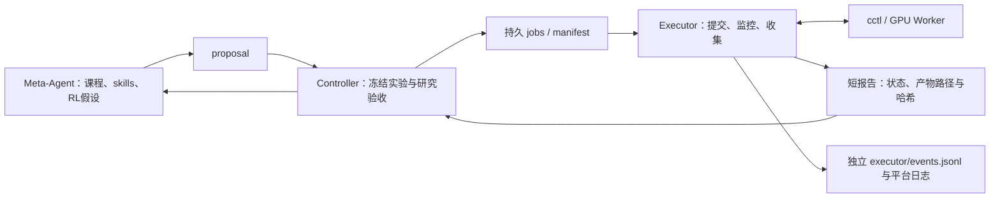

# Executor：把任务生命周期移出 Meta-Agent 上下文

本次补充分离提交、轮询、产物核验与日志收集。现有版本原本就由Python Controller轮询，等待任务时不会反复调用Codex；这次进一步抽出 [`remote/lifecycle.py`](../src/llmgo/remote/lifecycle.py)，将高频平台交互保存到独立日志，并提供独立进程部署。

## 角色与信息边界



| 角色 | 接收与处理 | 默认不注入的内容 |
|---|---|---|
| Meta-Agent | 完成/失败摘要、指标、证据路径，再决定如何学习 | 反复Running/Queued查询、原始cctl输出、大段训练stdout |
| Controller | manifest、短Executor报告、完整指标的程序校验与扶正/晋级 | 平台原始交互不进入其研究Memory |
| Executor | 已冻结任务、真实task ID、平台状态、原始返回、产物校验 | 不判断棋力、不改课程/skills/reward/验收阈值 |
| Worker | GPU采样、标注、RL、模型导出转换、正式评测 | 不负责强Agent的研究会话 |

Executor是确定性的Python组件，**不为常规轮询调用LLM**。它没有需要压缩的模型session；原始生命周期记录构成其独立执行历史。未来若加入LLM故障诊断，可只在异常时读取相关证据，但本次未新增第二个模型或额外推理费用。

当前检查点合并/导出在训练Worker内部完成，Executor监控该完整job。它没有把尚不存在的独立conversion任务类型包装成已实现功能。

## 持久文件与交接

```text
CAMPAIGN/
  events.jsonl                          # 研究/教练事实、少量生命周期转换
  memory.sqlite                         # 研究Memory索引
  executor/
    events.jsonl                        # 原始cctl命令/返回、每次平台观察、异常
    memory.sqlite                       # 独立执行历史索引
    heartbeat.json                      # 独立服务的最近观测时间/PID/host
    lifecycle.lock / service.lock       # 实际进程锁
  jobs/j000001/
    manifest.json                       # Controller冻结的输入
    submission.json                     # 提交intent与实际task ID
    executor/report.json                # 小型可重读交接报告
    executor/platform.log               # 终止时尽力收集的平台200行页
    output/                             # Worker完整应用日志、检查点及结果
```

`report.json`包含任务/manifest身份、状态、task ID、短摘要、下一次检查时间、已核验产物引用和原始证据路径。Meta-Agent的`context.json`只提取最新短摘要与引用，不包含每次检查历史。`memory --search`默认也只检索研究Memory，不递归混入Executor日志。

Worker的完整训练、vLLM、棋局日志保留在`output/`；平台`job logs --page-size 200`只是另一个有限尾部来源，不能称为完整训练日志。cctl可见输出逐次保留并脱敏。错误只把类型和短说明交接给主控，原始stderr/输出保留在执行日志。

## 两种启动方式

### 默认：单命令，组件分离

站点配置`executor_mode="embedded"`，默认`poll_seconds=30`、`executor_max_poll_seconds=120`。

```bash
python3 scripts/rsi.py run chess-rsi-001
```

Controller托管专用Executor组件；日志、数据契约和模型上下文边界已经分离，继续沿用一个启动命令。等待期间没有Codex turn，单纯轮询的模型token消耗为零。

### 独立进程：Controller只读本地报告

在**新campaign初始化前**，把自己站点配置的`executor_mode`改为`external`。站点配置随campaign冻结；旧campaign继续使用原配置，不中途篡改它的站点身份。

```bash
# 0 GPU devspace；两个终端均先激活自己的控制环境
python3 scripts/rsi.py init chess-rsi-external-001

# 终端A：只执行生命周期；没有campaign研究写锁，也不调用Codex
python3 scripts/rsi.py executor run chess-rsi-external-001

# 终端B：研究决策与验收；等待时只读取本地Executor报告
python3 scripts/rsi.py run chess-rsi-external-001
```

Executor可先启动，等待Controller写出active_job；Controller也可先启动，等待报告，期间不回退到自行提交。二者均在自己的0GPU devspace，不另建GPU devspace，不依赖开发机常驻。GPU仍由固定NORMAL/beijing/model-autosft单卡job承担。

未激活环境时，使用`/user/lyh4170/venvs/rsi-control/bin/python`；命令工作目录为`/user/lyh4170/LLMGo!`。自定义站点统一在子命令前加`--site /user/lyh4170/site.json`。

按需运维：

```bash
python3 scripts/rsi.py executor status chess-rsi-external-001
python3 scripts/rsi.py executor run chess-rsi-external-001 --once
python3 scripts/rsi.py executor step chess-rsi-external-001
```

`status`只读短报告；`run --once`执行一次服务遍历；`step`只处理当前active_job并尊重已持久化的下次检查时间。常驻服务运行时不必额外反复调用step。独立服务锁阻止重复启动，生命周期锁阻止并发提交/查询。

## 轮询、故障与恢复

- 状态未变时检查间隔逐步从30秒增加至最多120秒；状态变化恢复初始间隔。节奏写入报告，重启不丢。上限可通过固定站点配置调整，代价是完成发现延迟。
- 每次查询原文写独立日志；研究Memory仅记录有意义的状态转换。网页刷状态读取报告，**不会因此向集群发查询**。
- 已有task ID直接查询该ID，不反复走提交路径。创建响应不确定时沿用原intent对账；查不到也不盲目再创建任务。
- 当前真实v2任务列表只有`name=tasks/ID`，没有`id`及`description`；对账先规范化资源名，再查详情匹配唯一description。数字ID与资源名冲突、多个不同任务匹配或列表未完整枚举时保持不确定，保留intent；同一ID的别名不重复计数。该路径已用历史任务1310479完成真实只读核验，没有重新创建它。
- 单次查询逾时或连接失败记`retrying`，保留原任务并退避；它不等于任务已终止，不取消任务、不建立替代任务。
- 平台Succeeded但共享盘尚无结果记`waiting_for_artifact`；必须同时验证manifest及产物哈希，才能交接`collected`。哈希不符记`artifact_invalid`，阻止评分。
- 实际Failed/OOM等终止状态记`failed`，收集证据并交接；失败不由Executor自行调整RL配置或自动训练第二份。
- Controller停止后，独立Executor继续监控已有任务并发布报告；Controller恢复后读报告，仍执行正式指标/版本验收。Executor重启则读原intent、报告和真实平台状态。
- 心跳显示最近服务观测时间，不能单凭旧文件判定进程已死或重提任务。没有根据观察逾时自动停止任务的行为；资源及任务归属约束保持原样。

Meta-Agent可先看短摘要；确需诊断时，按report路径读取相关`failure.json`、训练尾部或具体执行事件。这样保留研究所需细节，也避免每轮自动灌入全部日志。教练长时间研究自身仍可能触发模型上下文压缩，此改动只消除任务轮询引起的负担。

## 网页与验证

`/rsi`的独立Executor区域每3秒读短报告和小型活动索引：显示每次轮询开始/完成、平台返回、命令起讫/耗时/退出码、失败及收集；支持筛选、较早事件、暂停和返回实时。最多80张卡片，原始输出点击后按64KiB分页读取，仍不进入强Agent思考流或上下文。网页不触发平台查询。

只读API包括`/api/rsi/campaigns/ID/executor`和`activity?source=executor`，原`executor-events`保留供显式查原文。完整字段与旧记录索引方式见[网页观测说明](rsi-observability.md)。Worker阶段和可读文件清单也在同一任务面板展示。

本机自动测试包括：371次模拟状态查询不触发Meta且不把原文写入研究上下文；真实独立Python子进程在Controller持锁时收集结果；Controller重启不重复提交；查询逾时保留原ID；退避持久化；失败日志只收集一次；结果身份不符阻止验收；独立API和网页原始日志按需加载。

这些是无模型、无集群副作用的工程验证，不是371次真实远端任务性能测量，也不是Qwen训练/Elo提升证据。本次未提交新远端任务。
