# 国际象棋 RSI：部署、实验与恢复

更新：2026-10-21。本文描述本次新增代码的实际接口；研究设计见 [plan.md](../plan.md)，历史任务和文件清单见 [rsi-submission-and-files.md](rsi-submission-and-files.md)。

**训练已按最新授权切换为固定Lc0 critic的PPO。** `hf_ppo` 是唯一可选后端；不训练学生value head、不做SFT，GRPO/旧verl接线已移除。默认γ=1、λ=0；单步棋局优势广播给生成token，逐token执行clip。真实Qwen GPU兼容性与20局改善仍待远端验收；配置与恢复见第5节。

此文件复制到每轮workspace时，根目录plan.md不会自动随行复制。远端教练读取完整设计应使用用户上传的开发仓库 `/user/lyh4170/LLMGo!/plan.md`；使用自定义repo时，从该campaign的campaign.json读取site.repo后定位plan.md。不要因workspace中的相对链接不存在而回退旧训练方案。

## 1. 运行位置和边界

本机 `/home/lif/LLMGo!` 开发并测试，由用户上传到 `/user/lyh4170/LLMGo!`。实际强 Agent、Controller、Memory、候选 workspace 和网页在用户自己的 **0 GPU devspace** 运行。GPU job 完成正式对局、离线标注及 RL；当前实现每个 job 用一张 GPU，同一 campaign 串行处理任务。

弱 Agent 只通过 **RL 更新权重、修改条件 skills** 两条路径改进。没有 SFT、教师答案交叉熵、蒸馏或行为克隆。正式棋手始终使用单题、全部合法 UCI 的 Harness，对手直接通过 UCI 下棋。教师和 Lc0 都不在正式棋手的决策路径中。

Meta-Agent 使用 Codex app-server 的 JSONL 接口，可替换实现 `MetaAgentBackend.turn(workspace, prompt)`。不设置强 Agent 整轮研究时间上限；协议握手有 120 秒超时，30 秒心跳用于检测连接，这与限制研究时间不同。

任务生命周期已由专用程序Executor承担；它的高频查询与cctl原始输出在独立`executor/events.jsonl`，Meta-Agent默认只读短报告与引用。默认`embedded`维持一条run命令；`external`支持单独常驻进程，Controller仅读本地报告。配置、启动、退避和交接详见 [Executor说明](rsi-executor.md)。

## 2. 上传与环境准备

### 2.1 文件及路径

上传整个项目，包含 `src/`、`scripts/`、`configs/`、`.agents/`、`docs/`、`engines/fairy-stockfish` 及其 NNUE 文件。不要漏掉隐藏目录 `.agents`。保留既有模型 `/user/liyaohu4170/models/Qwen3.5-4B` 只读；本次没有重写旧启动脚本的模型路径。

默认站点配置为 [`configs/rsi/site.beijing.json`](../configs/rsi/site.beijing.json)。核对这些字段：

| 字段 | 默认值 / 含义 |
|---|---|
| `user_root` | `/user/lyh4170`，远端唯一可写用户根 |
| `repo` | `/user/lyh4170/LLMGo!` |
| `codex_home` | `/user/lyh4170/.codex-rsi`，已经复制配置的目标 |
| `codex_bin` | `/user/lyh4170/tools/bin/codex`，仍需准备完整可执行程序及其依赖 |
| `base_model` | `/user/liyaohu4170/models/Qwen3.5-4B`，只读 |
| `engine` | 自己项目里的 Fairy-Stockfish，旁边需要原 NNUE 文件 |
| `lc0_bin` | `/user/lyh4170/tools/bin/lc0`，需要支持该网络和 CUDA backend |
| `reward_weights` | `/user/lyh4170/reward_models/lc0/BT4-1024x15x32h-swa-6147500-policytune-332.pb.gz` |
| `cluster / resource_pool / priority` | `beijing / model-autosft / NORMAL`，代码拒绝其他值 |
| `gpu_count` | `1`，当前实现不支持增到多卡后自动并行 |
| `python / image` | Worker 的 Python 与镜像；必须具备下述实际依赖 |

`checkpoint_root` 是预留的站点目录字段；当前检查点实际位于各 job 的 `output/training/`，不能仅备份预留目录。

若需适配自己的 Python 或二进制位置，编辑自己目录内的站点配置，并在 **init 之前** 完成。`--site` 位于子命令前。campaign 初始化后冻结站点配置，不允许在一次比较中偷偷更换环境。

此前成功任务只完成了 Codex **配置复制和文件校验**，不代表远端 Codex 程序、认证、provider bridge 或实际推理已经可用。来源目录当时没有 `auth.json`；不要据此假设复制配置就具备独立认证，也不要打印配置内容排查密钥。

### 2.2 Python 依赖

devspace 在自己目录建立环境，安装 `requirements-rsi-control.txt`；也需可用的 `cctl` 和 Codex 程序。实际运行仍在 devspace，开发机不作为长期调度节点。

```bash
cd '/user/lyh4170/LLMGo!'
mkdir -p /user/lyh4170/tmp /user/lyh4170/cache
export TMPDIR=/user/lyh4170/tmp XDG_CACHE_HOME=/user/lyh4170/cache
python3 -m venv /user/lyh4170/venvs/rsi-control
/user/lyh4170/venvs/rsi-control/bin/pip install -r requirements-rsi-control.txt
```

Worker 依赖 CUDA、PyTorch、可运行 Qwen3.5-4B 的 vLLM/Transformers、PEFT、Accelerate 和 Safetensors。`requirements-rsi-worker.txt` 是额外依赖清单，**不是已验证的 GPU lockfile**。已有 vLLM 镜像不能直接视为训练镜像，不能盲目升级它的 Torch/CUDA。

后面的简写 `python3 scripts/rsi.py ...` 均指使用已激活的自己控制环境；未激活时替换为上面的绝对Python路径。

Qwen3.5 是带视觉架构的模型，原生训练保留模型外壳，只使用文字输入，冻结基础权重并训练语言侧 LoRA。加载使用能识别 `qwen3_5` 的 Transformers；官方部署说明和当前 API 见 [模型卡](https://huggingface.co/Qwen/Qwen3.5-4B) 与 [Transformers Qwen3.5](https://huggingface.co/docs/transformers/model_doc/qwen3_5)。实际 Worker smoke 后应固定镜像、包版本与Lc0程序，不把本机数值单测当作 GPU 兼容证明。

可在自己的共享目录准备 Worker 环境，把站点 `python` 指向该环境的 Python。**其 `vllm` 命令也必须在 Worker PATH 中且与此环境匹配**；评测复用既有 `VllmServer`，通过 `vllm serve` 启动服务。使用自定义环境时，在镜像 PATH 中配置其 `bin` 目录。

### 2.3 单一评估网络

本机已下载：

```text
/home/lif/.cache/llmgo/reward_models/lc0/BT4-1024x15x32h-swa-6147500-policytune-332.pb.gz
大小：382645315 bytes
SHA256：e6ada9d6c4a769bfab3aa0848d82caeb809aa45f83e6c605fc58a31d21bdd618
```

用户将它上传到站点 `reward_weights`；不需要重复下载或提交 Git。仅允许这一份 BT4-it332 网络，[官方网络页](https://lczero.org/play/networks/bestnets/)。代码校验其 SHA；文件完整性已经验证，实际 Lc0 CUDA 推理和预算准确性仍需远端测量。

### 2.4 检查与启动

以下命令都在 **0 GPU devspace** 内执行；`doctor` 不提交任务、不推理。

```bash
cd '/user/lyh4170/LLMGo!'
/user/lyh4170/venvs/rsi-control/bin/python scripts/rsi.py doctor --platform
/user/lyh4170/venvs/rsi-control/bin/python scripts/rsi.py init chess-rsi-001
/user/lyh4170/venvs/rsi-control/bin/python scripts/rsi.py run chess-rsi-001
```

完整运行会提交实际 GPU 任务。第一个任务是初始学生 L1 的 20 局基线；基线完成且未满足升级时，才调用强 Agent 准备候选。不要同时再开第二个 `run`。`run --steps 1` 是运维的有限步调试选项，不是默认强 Agent 时间预算。

Worker 的依赖检查使用相同 `doctor --worker`，应在自己的计算 job 内执行；不能在 devspace 为检查而申请 GPU。`doctor` 主要核对文件、程序、包和 CUDA 可见性，并不替代模型生成、反向传播或 Lc0 推理 smoke。

## 3. 每轮实际流程

```mermaid
flowchart TD
    A[20 局现任基线] --> B{现任连续两批达标?}
    B -- 是 --> C[升级对手并重新测基线]
    C --> B
    B -- 否 --> D[Codex 在 devspace 阅读 Memory 并准备实验]
    D --> E[冻结 skills / 课程 / RL 配置]
    E --> F{包含 RL?}
    F -- 是 --> G[GPU job 离线 BT4 标注并 RL 更新导出]
    F -- 否 --> H[候选 20 局正式评测]
    G --> H
    H --> I{同级比较是否改善?}
    I -- 不明确 --> J[补一批匹配基线和候选 20 局]
    J --> I
    I -- 是 --> K[已有通关级的回归评测]
    K --> L{未退步?}
    L -- 是 --> M[扶正候选]
    I -- 否 --> N[保留现任并记录失败]
    L -- 否 --> N
    M --> B
    N --> B
```



首级尚无已通关难度时无需回归评测。比较最多两批；证据仍不足记 `inconclusive`，不扶正。每轮尝试不保证真实提升，现任更替必须有实测依据。

### 正式评测

每批恰好 **20 局，10 白 + 10 黑**；按 10 个模型 seed 各下黑白一对。开启 thinking，每手生成总预算 32768 tokens，单请求 540 秒，整手 1800 秒，上限 200 **半步**。全部合法候选均保留；两次作答共用本手 token 额度。

每次比较冻结源码、条件卡片、模型权重及 tokenizer、引擎二进制和 NNUE、难度参数、协议和 seed schedule。模型服务每批重新启动，加载实际检查点，而非只改 served-model-name。Fairy-Stockfish 的内部随机性未被上述模型 seed 固定，不能宣称完全消除了对手随机方差。

候选采用按黑白 seed 对聚类的 bootstrap 比较：得分率增量至少 0.05，95% 区间下界大于 0 才接受；无正增量拒绝，其余补样或记不明确。这是小样本开发验收，不是每次接受都有严格独立 95% 保证，也不是校准的人类 Elo。重复自适应尝试需要另外组织最终留出研究。

**不以 random_rate 或“学生决策健康”阈值否决晋级。** 后备原因、模型选择率仍完整记录用于诊断。基础设施失败局不能删去后按剩余局数计算胜率；该任务失败并保留证据。

### 对手升级

同一现任学生在当前级 **连续两批** 各满足：胜至少16局、得分率至少0.85、执白和执黑得分率各至少0.60，才升一级；得分率为 `(胜 + 0.5×和) / 总局数`。

| 级别 | Skill | depth | 每步时间 | 说明 |
|---|---:|---:|---:|---|
| L1 | -9 | 5 | 0.05s | 项目最低档，从此开始 |
| L2 | -5 | 5 | 0.10s | 沿用原参数 |
| L3 | -1 | 5 | 0.15s | 沿用原参数 |
| L4–L8 | 3、7、11、15、20 | 5 | 0.15s | 已接线，实际强度未校准 |
| L9+ | 20 | 无 depth cap | 不设时间 cap | 只按 nodes，上一级两倍 |

进入 L9 前，从 L8 两批记录的实际 `engine_search.nodes` 取最大值的两倍，至少1000，作为 L9基数；缺少记录停止升级并报告缺失项。**不把 skill 调成24/28，也不让 depth5继续压住节点预算。** L1–L3 旧锚点只是项目比较标签，L4+不伪造 Elo。

网页新建普通对局可选 L1–L8；命令行 `eval_harness.py --opponent-level N` 与 `arena_ladder.py --level N` 复用同一注册表，L9+需另传 `--nodes-base`。旧命令未选择等级时保留现有协议行为。RSI 的20局设置独立于旧评测脚本的默认局数。

## 4. Meta-Agent 如何提出候选

Controller 在 `PLANNING` 为每轮创建 `/user/lyh4170/rsi_worktrees/CAMPAIGN/round-NNNNNN`，含：

- `context.json`：当前状态、近期结论和证据位置。
- `skills.json`：现任卡片副本，可修改。
- `curriculum.jsonl`：可修改的训练局面；初始16个可复现随机合法对局局面，只是种子课程，不冒充人类棋谱。
- `.agents/skills/` 与 `docs/`：操作知识。

`proposal.json` 示例（skills-only）：

```json
{
  "mode": "skills",
  "hypothesis": "优先识别被攻击后的回吃损失，减少无补偿送后",
  "evidence_refs": ["jobs/j000001/output/harness_runs/某局/events.jsonl:request_id"]
}
```

应实际修改 `skills.json`；无变化会被拒绝。每张卡需 `id/title/priority/stages/trigger/when/rule/counterexample/sources`，仅 `stages=["move"]`；支持现有13种触发器，最多64卡、单卡正文最多2200字符、每手最多注入2张，priority0–100。`when` 是可见说明，实际触发由 `trigger` 决定。不能编一个未实现 trigger 当成已生效规则。

PPO候选示例（`steps`表示重新采样的批次数）：

```json
{
  "mode": "rl",
  "hypothesis": "用固定Lc0逐步优势降低真实对局中出现的回吃失误",
  "evidence_refs": [],
  "training": {
    "backend": "hf_ppo", "batch_size": 8, "steps": 16,
    "ppo_epochs": 4, "minibatch_size": 2, "clip_range": 0.2,
    "learning_rate": 0.00001, "kl_beta": 0.02, "lora_rank": 16,
    "max_response_tokens": 2048, "max_prompt_tokens": 8192,
    "seed": 4170, "checkpoint_every": 4
  },
  "reward": {"mode": "lc0_bootstrap", "nodes": 10000, "backend": "cuda-auto"}
}
```

旧`hf_grpo`/`verl`、`group_size`、`quality/delta/sign/terminal_only`及`epsilon`字段会明确报错，不自动迁移旧实验。新代码需新campaign源码快照；已冻结的旧campaign保持原事实，不能往旧GRPO检查点上接PPO。

`rl` 不能同时改卡片；两者都改使用 `rl_and_skills`。重试相同实验指纹需补 `repetition_reason`。不支持任意 shell trainer 命令、SFT 配置或未知字段。

结束时强 Agent 返回：

```json
{"status":"ready","summary":"主要假设和证据","proposal_path":"/user/lyh4170/rsi_worktrees/CAMPAIGN/round-000001/proposal.json"}
```

Controller正在调用强Agent时持有campaign研究写锁，Agent只准备proposal，不从子进程再次调用`prepare/submit/run`。Controller协调专用Executor自动提交；有效授权已存在，不需要每轮重复请求用户许可。Executor有独立生命周期锁，external服务无需取得研究写锁。

## 5. 固定Lc0 critic的PPO

课程只有可重放局面、历史和来源，没有教师答案：

```json
{"initial_fen":"rnbqkbnr/pppppppp/8/8/8/8/PPPPPPPP/RNBQKBNR w KQkq - 0 1","moves":["e2e4","e7e5"],"source":"开发对局路径:行号","split":"train","history_complete":true}
```

用`python3 scripts/rsi.py curriculum --events /user/lyh4170/某局/events.jsonl --count 32 --output /user/lyh4170/课程.jsonl`提取实际局面。保留全段历史、重复与50步规则；不捏造中盘FEN此前的历史。默认随机种子课程仅用于开发，实际RSI应逐轮加入失败对局局面；留出集不能进入课程。

### 价值、优势和终局

Lc0 BT4原生WDL给出`E=W+D/2`，转换为`V=2E−1=W−L`，范围[-1,1]，而非旧E差分。前后都用`wdl.pov(actor)`固定学生执棋方；走完一步换成对手行棋时不能直接取相反方分数。[Lc0 WDL说明](https://lczero.org/blog/2020/04/wdl-head/)

| 情况 | r_env | continuation | A=r_env+continuation−V_before |
|---|---|---|---|
| 非终局合法一步 | 0 | V_Lc0(after_student_move) | V_after−V_before |
| 规则终局 | 胜+1、和0、负−1 | 0 | 实际结果−V_before |
| 完整历史达到200半步，且无更早规则终局 | 0，协议和棋 | 0 | −V_before |
| 非法答案、未闭合thinking或生成截断 | −1，训练协议惩罚 | 0 | −1−V_before |
| Lc0故障、缺原生WDL、非有限值 | 任务失败 | 不补零 | 不更新该批 |

协议惩罚不是实际输棋，不调用随机后备，也不从thinking猜UCI。先判断真实规则终局，再判断200半步封顶；将杀在第200半步仍记真实结果。非终局的一步片段末端保留bootstrap，不冒充终局；不再叠加一次ΔV reward，否则会双算。γ=1、λ=0固定，无组内归一化、无learned critic、无GAE。这属于棋步级反馈；严格说ΔV是TD advantage，并非再加一份r_env。相同棋步优势广播到该次回答token，不是逐token另向Lc0请求奖励。

该方案信任外部Lc0续盘价值，不等于学到了当前Qwen对当前Fairy的V^π；这是用户选择的固定critic近似。当前训练从课程局面采样一步，next_state为学生刚走完一步后的局面，没有采样Fairy应手或整盘轨迹。正式比赛仍独立对Fairy下20局，最终以其结果验收。

### PPO更新粒度

每批从当前策略采样`batch_size`条完整回答，`enable_thinking=True`，复用正式全部合法UCI与条件卡片。采样temperature1/top_p1/top_k0、无repetition penalty、无约束或forced token，避免行为分布与logprob不一致。正式评测的采样配置与32768预算保持原样；训练生成预算默认2048，可显式增大至32768。

每条回答的棋步优势A广播给真实生成token（含thinking、UCI及EOS）。ratio是**逐token**的`exp(new_logp−old_logp)`，取`min(ratio*A,clip(ratio,.8,1.2)*A)`，另加冻结父模型的token KL。每条回答先对token取均值，各回答等权，再做minibatch均值；这不是完整回答联合概率clip，也没有token级value head。[PPO原论文](https://arxiv.org/abs/1707.06347)

behavior logprob由生成当下的无改写logits捕获，只缓存一行词表；另记与无缓存重算logprob的最大差值，便于诊断混合注意力/数值误差。old/reference logprob和A在同批所有epochs中固定；每批默认4轮、minibatch2。批次用完丢弃，不把旧回放当新on-policy样本。不对prompt/工具/后备/教师token计算梯度；唯一合法步在课程载入时过滤。整个batch优势为0跳过，整轮零更新拒绝导出；不会用组内方差为0来跳过非零Lc0优势。

### 显存、诊断和恢复

Qwen采样→学生权重移CPU→Lc0对实际采样动作前后评分→Lc0退出→Qwen回GPU更新。LoRA和冻结父模型共享基底，不额外复制一个完整reference；optimizer状态可能仍占GPU。真实H800峰值、吞吐与CUDA组合需远端测量，不保证仅凭卸载就已跑通。

`output/training/rollouts/*-sampled.jsonl`逐笔fsync保存原文/IDs/masks/behavior及reference logprob；`*-targets.jsonl`逐笔保存固定视角WDL、前后FEN、真实动作、r_env、bootstrap、A、边界与错误。完整批次`.json`绑定课程/skills/critic/配置身份。`training.jsonl`记录每个epoch/minibatch的loss、KL、old KL和clip fraction；没有SFT/critic回归损失。`latest.json`只指向最近一批，网页读取文件元数据，原文按需64KiB分页，不扫描全部buffer、不传给Meta默认上下文。

每`checkpoint_every`批保存LoRA、AdamW、CPU/CUDA/Python RNG、课程/skills/critic身份和文件SHA；临时目录完成后原子发布。只从完整批次检查点恢复，批中断则重采该检查点之后的数据，不声称恢复到半个minibatch；原日志保留作证据。身份不符或文件变动拒绝恢复。

最终合并LoRA为完整HF模型，保留Qwen3.5架构、tokenizer及processor元数据，再由正式评测重载；不导出或接入Lc0。本机另外用随机初始化的微型Qwen3.5（完整视觉外壳、线性＋完整注意力、真实Qwen tokenizer）跑通生成、LoRA/PPO更新、完整HF导出、重载生成与跨批恢复的一致性。可复核命令：

```bash
LLMGO_QWEN_TINY_TEST=1 PYTHONPATH=src python -m pytest -q tests/test_rsi_qwen_ppo.py tests/test_rsi_gradient.py
```

该可选测试需PyTorch/Transformers/PEFT环境；已在本机torch2.11.0+cu130、transformers5.20.2、peft0.21.2的CPU上通过，不是远端镜像lockfile。CPU数值/微型架构测试不能替代真实4B单卡训练、BT4推理、vLLM重载和20局比较。

## 6. Memory、恢复和升级框架

campaign 的 `events.jsonl` 是追加式事实日志，SQLite 是可重建查询索引；`campaign.json` 是网页快照，Controller 从 journal 恢复状态。每轮写 `memory/handoff.json`。原始模型/工具交互不只留在 short_events；Codex 可见 JSONL 请求/通知/输出也记录，认证字段脱敏，不声称获取模型服务没有提供的隐藏思考。

强Agent本轮完成或失败后，后端仍收集子进程退出时已读到的尾部协议事件和stderr，并更新最后用量；不因收到`turn/completed`就丢弃队列。收尾仅保存证据，不对已关闭的输入再次发RPC。退出诊断沿用同一脱敏与活动索引，网页可继续查看。

```bash
python3 scripts/rsi.py status chess-rsi-001
python3 scripts/rsi.py memory chess-rsi-001 --search queen --limit 10
python3 scripts/rsi.py memory chess-rsi-001 --kind decision
python3 scripts/rsi.py note chess-rsi-001 --text '证据位置与新的可证伪假设'
python3 scripts/rsi.py run chess-rsi-001
```

重启用同一 campaign。恢复时保留 app-server thread/turn，已完成且尚未处理的同一上下文返回结果可重用；前一个 Codex 子进程仍存活或线程仍有进行中 turn 时不启动重复 turn。上下文变更（如上次 proposal 校验失败）会开启新 turn。共享盘锁与 SQLite/原子替换语义在实际集群尚需验证；损坏 journal 会报告具体行，不静默丢记录。

Executor提交前先写durable intent；已知task ID只查询，响应不确定仅对账、不盲目重提。内嵌模式的`submission_uncertain`会让研究循环返回；保留intent后重启run继续对账。独立Executor可继续对账并发布新报告，Controller退出后也不丢原任务。观察逾时记retrying并保留原ID，不当作终止。

平台失败时保留完整 job，状态 `FAILED`。诊断并解决环境原因后：

```bash
python3 scripts/rsi.py resume-failed chess-rsi-001
python3 scripts/rsi.py run chess-rsi-001
```

此操作先确认旧任务已终止，再创建新任务；原生训练从旧任务最近完整 checkpoint 恢复 optimizer/RNG。正式评测重跑完整20局，旧失败局保留但不混入新批分数。`NEEDS_INPUT` 的具体缺失项解决后才 `resume`；代码/身份错误直接报错，不能改已有分数“修复”。

campaign 冻结源码；修改项目代码不会自动改变正在运行的 campaign。基础设施更新应新建 campaign、重测基线。可复用学生模型/卡片的迁移入口尚未提供，不能直接改 journal 把两个协议的结果拼起来。

## 7. 网页与研究结论

在 devspace 用控制环境启动只读网页，无需给网页分配 GPU：

```bash
cd '/user/lyh4170/LLMGo!'
LLMGO_RSI_ROOT=/user/lyh4170/rsi_campaigns PYTHONPATH=src \
  /user/lyh4170/venvs/rsi-control/bin/python -m uvicorn llmgo.server.app:app --host 0.0.0.0 --port 7860
```

打开 `/rsi`：强Agent状态、文字/工具起讫/用量/错误，Executor每次轮询与cctl命令耗时，Worker阶段、学生棋盘/实时文字、Memory假设结论、最近200条评测及执行成本。每3秒读取有界活动索引，初次直接取最新页；原有对局页仍保留WebSocket/SSE体验。每列表最多80张卡片、串流合并、详情延迟展开，原文按64KiB分段读取。页面隐藏或手动暂停即停止自动刷新；网页不会触发cctl或强模型调用。

旧campaign若缺索引，可在原控制环境运行`python3 scripts/rsi.py index-activity CAMPAIGN`，沿用原站点配置；它只补建可重建索引，不改原始日志。完整字段、文件、API、历史翻页、升级与负担控制见[网页观测说明](rsi-observability.md)。新起讫事件和Worker进度只对升级后运行相应代码的进程生效，不补造旧历史或改冻结实验源码。

图上成本为已收集成功任务的 `Worker执行墙钟时间×分配卡数`，不包括排队和容器启动，不是 GPU 活跃时间/FLOPs；失败任务的时间可从 `failure.json` 追查，暂未汇入该图。强 Agent 的可见用量事件保留，但暂未统一计价。颜色分等级，纵轴是得分率；不把 L4+编成校准 Elo，不把 mocks 测试分数当 Qwen 棋力。

本次完成的是本地可测试实现。仍需用户上传后验证 Codex 实际调用、BT4 CUDA 推理、Qwen RL反传/导出/vLLM重载、共享盘恢复，并实跑至少一轮20局前后比较，才能宣布远端闭环跑通或棋力改善。

## 8. 本机交付包与已确认的部署缺口

2026-10-21任务1318184已在共享盘核验：用户目录和已复制Codex配置存在，原学生模型的config/tokenizer存在；自己目录中的当前RSI入口、Codex程序、控制venv、Fairy、Lc0及BT4尚不存在。该任务使用0GPU/1CPU/2GiB、NORMAL/beijing/model-autosft，仅新增自己的检查回执，没有安装软件或改程序。

本机交付目录为 `/tmp/llmgo-rsi-upload-20261021/`，源码包 `LLMGo-rsi-source-20261021.tar.gz` 内层目录为 `LLMGo!`，包含当前源码、脚本、配置、.agents、docs、研究计划、测试源码与原有Fairy/NNUE；外附逐文件manifest及SHA256SUMS。它是当前工作区快照，不是干净Git提交，已包含本次PPO实现；旧同名交付快照已被新包取代。模型、认证、venv、.git和历史runs不在源码包中。

BT4仍使用本机 `/home/lif/.cache/llmgo/reward_models/lc0/BT4-1024x15x32h-swa-6147500-policytune-332.pb.gz`，由用户另行上传到站点指定自己的目录；不复制原学生模型或重写其路径。源码包尚未由Agent上传或解压到远端。上传后应先对照外附manifest核验内容，再按第2节准备控制环境/Codex/Lc0；仅有Codex配置不等于已有可执行程序与可用认证。

包内RSI专项测试不依赖PostTrainBench；完整项目测试另含依赖兄弟PostTrainBench与历史runs的回放项，需要相应原有资料。不要将专项通过称为完整回归通过，也不要把本机测试当成真实Qwen训练。PPO已本机实作；进入远端训练前仍需真实Qwen/BT4单卡smoke。

## 9. 整条pipeline复核与远端就绪状态

2026-10-21复核覆盖：强Agent工作目录/提交skills、冻结proposal/manifest、Executor防重与恢复、PPO训练/导出接线、20局评测、网页、PostTrainBench打包。修复：

| 问题 | 修复与验证 |
|---|---|
| 训练重试在生成新检查点前再次失败，会丢失更早的resume来源 | 新任务没有完成检查点时继承既有resume_from；已有更新检查点时优先用新目录，回归覆盖连续三次重试 |
| vLLM本机就绪请求可能绕到外部HTTP代理 | 仅该loopback请求禁用代理；用真实本地HTTP服务＋故障代理验证，模型/引擎路径未改 |
| Controller只凭训练回执哈希便接入候选 | 另核对父模型SHA、完整训练配置、sft_enabled=False及新模型身份；不匹配不进入评测 |
| doctor将文件存在与可用认证混为一层、平台检查可能无限等待 | 增加可选`--codex-auth`，在指定CODEX_HOME运行有30秒上限的login status且隐藏原始输出；平台查询90秒上限并解析own-pool JSON；检查失败退出码1，通过为0 |

`doctor --platform --codex-auth`不做推理、不训练、不提交任务。CLI登录状态仅证明所报告的认证状态，不能证明provider可达、账号有模型权限或真实模型调用成功；自定义provider可能使用自身凭证。[官方登录状态说明](https://learn.chatgpt.com/docs/developer-commands?surface=cli)

### 当前远端事实

0GPU检查任务1321064成功写回执；短任务stdout未归档，因此另用0GPU只读任务1321123读取同一回执并自然结束。两者均NORMAL/beijing/model-autosft、CPU1/2GiB；没有停止其他任务或改动来源目录。回执时间`2026-10-21T09:14:13Z`，远端`/user/lyh4170/rsi_readiness/pipeline-audit-20261021T091413.json`；本机留存`/tmp/llmgo-pipeline-audit-result.json`。

| 站点指定项目 | 核对结果 |
|---|---|
| `/user/lyh4170/.codex-rsi/config.toml` | 存在、TOML可解析；SHA仍9d4360ad…6a0cb9 |
| 该配置实际模型 | `model=deepseek-v4-pro`，provider=`custom`；不是把Codex客户端等同于OpenAI推理模型 |
| `/user/lyh4170/tools/bin/codex` | 不存在，尚不能启动本站点配置的Codex后端 |
| `/user/lyh4170/.codex-rsi/auth.json` | 不存在；未核实devspace环境变量或其他凭证存储，不据此单独断言所有认证方式均失效 |
| 控制Python、RSI入口/PPO/site配置 | 站点指定的自己目录路径尚不存在，仍待用户上传和准备环境 |
| Fairy、Lc0、BT4 | 站点指定的自己目录路径尚不存在 |
| 既有devspace1309690 | Running，0GPU；只证明平台实例状态，不证明容器内部工具可用 |
| 实际强模型请求、4B/BT4 GPU、20局改进 | 尚未验证 |

`site.meta_model=null`会沿用上述复制来的默认模型；指定其他强模型需用户确认后配置，不在本次审查中偷偷改默认。模型/服务器路径保留原样。本次不是部署操作，未安装远端程序、复制认证或重写config.toml。

### 强Agent如何提交

workspace已携带`.agents/skills/rsi-submit`、`cctl`、`rsi-executor`、`rsi-rl-review`和操作文档，后端指示它读取。常规流程是Agent写proposal→Controller冻结→Executor按固定资源提交、轮询、收集→Controller验收；Agent不需要每30秒发状态查询。独立运维下可按第4节和提交文档使用preview/submit/run。文档与接线已验证，但远端尚未部署，所以不能宣称强Agent已在那个devspace成功执行过完整闭环。

### 清理与验收

保留前次已删除的8个旧规划/启动/整合patch文件；另外删除5个对应已删程序的无源`.pyc`：grpo、verl_adapter、verl_reward、run_five、run_parallel。其他旧模块仍被网页、录像、回放、测试或封装引用，保留当前依赖，不删除运行日志、棋谱/skills证据、引擎与NNUE。

本机完整回归190通过、4项默认跳过；另启用PPO数值＋微型Qwen3.5整合11通过、Chromium1通过、两套Node DOM通过。真实PostTrainBench packager在隔离临时目录重包并验证封装评测help，未改原PostTrainBench seal。这些支持已测工程路径，不保证不存在潜在bug，也不代替远端部署与真实4B比赛。
