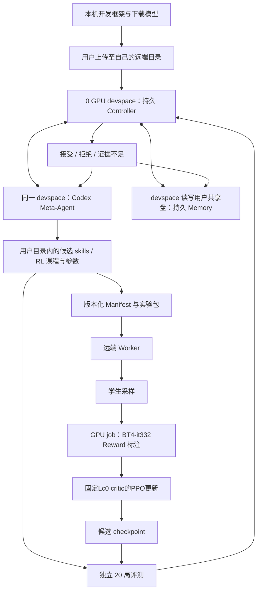

# LLMGo! 国际象棋 RSI Loop 详细计划

更新日期：2026-10-21（Asia/Hong_Kong）。状态：**第一版框架已在本机实现；已按最新授权实现固定Lc0 critic的PPO，尚待用户上传及远端GPU验收。**

用户此前“先规划”阶段已经完成唯一模型下载、远端只读核对与获授权的配置复制，历史事实见第15、24节。后续已按授权新增Controller、Memory、Codex后端、提交防重、20局验收/晋级、离线Lc0价值、PPO训练、RSI网页及操作skills。模型路径保持原样；框架初次实作未提交远端训练，后续连线核验只使用0GPU检查任务，事实分别记录在第23、24节，尚无已训练出更强学生的证据。

**实际命令、proposal字段和恢复方式以 [RSI操作文件](docs/rsi-operations.md) 为准；[任务与文件清单](docs/rsi-submission-and-files.md) 逐项记录此次实现。** 下文保留研究设计与后续扩展，不把建议中的每一个接口/指标视为已实现或已远端验证。

| 能力 | 当前实施状态 | 下一项证据 |
|---|---|---|
| Memory/Controller/Codex | 已实现；本机恢复、去重和 JSONL 子进程模拟测试 | 用户 devspace 的真实 Codex 调用与共享盘恢复 |
| skills 候选与20局验收 | 已实现冻结、比较、回归、扶正及不明确结论 | 真实 Qwen 两个冻结版本完整比赛 |
| 难度阶梯 | 已统一 L1–L8，L9+节点倍增；本机真实引擎测试 | 相邻档强度校准与实际通关证据 |
| Reward | BT4-it332原生WDL与一步动作标签；可不用网络 | 远端 Lc0 CUDA 推理、准确性与预算验证 |
| RL | 已实现`hf_ppo`：固定Lc0 critic、TD(0)、逐token clip，见第14节 | 真实Qwen/BT4单卡采样、clip更新、导出/vLLM重载及20局验证 |
| 网页/操作skills | 已加入 `/rsi` 和5份可上传skill；强Agent事件、用量、Executor逐次轮询、Worker阶段、有界索引与按需原文 | 真实远端长时日志负载；本地真实Chromium交互/手机布局已验证 |
| 执行器隔离 | 已拆出JobExecutor，独立原始日志与短报告；支持独立进程，常规轮询不调用LLM | 实际集群长任务与共享盘部署恢复 |
| 科研提升结论 | 尚无本轮实测提升证据 | 独立对局与消融；不能用mocks或loss代替Elo |

部署形态以最新要求为准：**开发实现在本机 `/home/lif/LLMGo!`，由用户上传；实际 RSI 的强 Agent、Controller、Memory 与工作副本运行在用户自己的远端 0 GPU devspace，再通过 cctl 提交 GPU Worker。** 旧方案中的“教练长期运行在本机”已取消。

本计划取代上一版“SFT + RL + 任意 Harness 修改”的方案：弱 Agent 的能力改进仅允许 **RL 更新权重** 和 **修改学生 skills**。Meta-Agent 使用固定的强模型，通过持久记忆改进规划；本阶段不训练强模型，也不对学生进行 SFT。

## 1. 研究目标与约束

研究问题：固定 Qwen3.5-4B 模型家族与正式下棋接口后，强 Agent 能否通过跨轮经验记忆、自适应课程、RL 与条件技能，在累计计算投入增加时持续提升学生的实战能力？

| 用户要求 | 本计划中的具体含义 |
|---|---|
| 不限制强 Agent 时间 | 不继承 PostTrainBench 的十小时教练期限；controller 持续管理研究，支持跨进程、跨任务恢复；单个任务和请求仍有故障检测与检查点 |
| 只允许 RL 和改 skills | 权重更新采用 RL；学生可变提示内容只来自条件技能；禁止 SFT、教师答案交叉熵、行为克隆、SFT warm-up、监督式思考链蒸馏与自动换成其他棋类微调模型 |
| PPO与step-level回馈 | 已按最新授权实现PPO，固定Lc0 bootstrap；旧GRPO实现及verl GRPO入口已移除 |
| 局面模型 reward 可选 | 只保留并下载 Lc0 BT4-it332；RL 可选使用该模型的局面质量/变化量，或不用模型、仅用终局奖励；不维护多个候选模型 |
| 持久 Memory | 保存可取得的完整强 Agent 交互、棋局证据、实验及失败记录，并提供强 Agent 的读写 Memory skill |
| 每轮评测 20 局 | 每个候选的正式测量为 20 局，学生执白 10、执黑 10；失败或继续尝试均保留记录 |
| 有进步才扶正、达标持续晋级 | 候选必须在同一难度下证明改善才能替换 incumbent；已扶正版本通关当前难度后自动挑战下一档，不能一直刷简单对手 |
| 强 Agent 可提交远端任务 | 使用 cctl；仅 NORMAL、beijing、model-autosft；GPU 通过 job / pytorchjob；devspace 如使用必须 0 GPU |
| 本机开发、远端运行 | 本机实现框架并交给用户上传；用户自己的 0 GPU devspace 保存教练、候选修改、调度和记忆；GPU job 执行采样、标注、训练和评测 |
| 目录与配置来源 | 已核实的 `/user/lyh4170` 为远端唯一项目可写根；`liyaohu4170` 下获授权的 Codex 配置只读复制到该根内，不能在来源目录运行或写入状态 |
| 可基于 verl | 当前采用原生HF PPO；旧verl GRPO适配已移除，未来如迁移verl须另行适配固定外部critic |
| 只关注国际象棋 | 本期不扩展中国象棋、五子棋或围棋，不修改其现有实现 |

必须区分“每轮都追求进步”和“保证每次实验都进步”：后者无法由随机训练与 20 局测量保证。系统保留 incumbent（当前最佳版本），拒绝退步候选；没有改善的一轮记录为失败或证据不足，不伪造提升，也不自动替换 incumbent。

正式比赛保留当前选择题 Harness：全部合法 UCI、单个完整走法问题、`enable_thinking=True`、最多 200 半回合、每手总生成上限 32768 tokens、默认至多两张条件技能。正式时不得访问外部局面价值模型、棋步教师、开局续着表或额外搜索引擎。

当前请求超时 540 秒、整手 1800 秒属于学生执行协议，与“不限制强 Agent 的总研究时间”不同；本次不更改它们。

## 2. 当前仓库依据与可复用边界

调研起点为本机 `main` 的 `1e4e4d2`；`skills_docs.md` 是上一轮已有的未跟踪文件，本次保留。

| 已有组件 | 依据 | 本计划的处理 |
|---|---|---|
| 选择题与完整诊断 | `src/llmgo/harness/agent.py`、`player.py` | 固定为学生运行基础设施，保留思考边界恢复 |
| 13 张条件技能 | `harness/skills/cards.json`、`skills.py` | 作为第一代技能库与检索机制起点 |
| 对局循环 | `runner/harness_loop.py` | 正式对局复用；训练起局另加课程适配层 |
| 双日志 | `store/jsonl.py`、`store/compact.py` | 原始日志为权威证据，短日志负责检索与初筛 |
| 批量评测 | `scripts/eval_harness.py` | 旧命令保留；新增evaluator复用其服务启动器并固定20局 |
| 对手难度 | `scripts/arena_ladder.py`、`rsi/ladder.py` | 已统一注册表并接入晋级，参数未做真实强度校准 |
| 网页棋盘与流式输出 | `server/` | 扩展教练、轮次、记忆与训练视图，保留逐局诊断 |

规划起点没有RSI运行模块；本轮已新增这些代码。旧生成日志不能直接当成on-policy PPO buffer，新训练必须从对应当前策略重新采样并记录概率/版本，不能复用旧答案冒充本轮采样。

不依赖 PostTrainBench 调度、十小时计时或 seal 工作流；可借鉴版本快照和固定验收思想，但最终主入口、状态及数据契约均归 LLMGo!。本轮不修改 PostTrainBench。

## 3. 开发位置、远端控制端与计算 Worker

下表规定最终运行位置；后文未重复写位置的 Meta-Agent、Controller 和 Memory 操作，一律发生在用户自己的 0 GPU devspace 中。开发机是框架交付来源，日常 RSI 不依赖开发机在线。

| 位置 | 承担工作 | 持久文件位置 |
|---|---|---|
| 本机开发环境 | 实现与检查框架、整理交付模型；由用户首次上传，之后按需发布基础设施更新 | `/home/lif/LLMGo!` 与已注明的本机下载缓存 |
| 远端 0 GPU devspace | Codex Meta-Agent、Controller、Memory 读写与查询、候选 skills/RL 配置修改、cctl 调度、结果分析、网页后端 | `/user/lyh4170`；campaign 统一为 `/user/lyh4170/rsi_campaigns/<campaign_id>/` |
| 远端 job / pytorchjob Worker | Qwen 采样、Lc0 离线标注、RL 训练、20 局评测 | 同一 `/user/lyh4170` 共享盘，按冻结 Manifest 读输入、写产物 |



| 角色 | 职责 | 不承担的职责 |
|---|---|---|
| Meta-Agent | 读 Memory、解释失败、研究可选 reward、改学生技能、规划 RL 课程与参数、提交/追踪本项目任务 | 正式对局中替学生实时选步、SFT |
| Controller | 状态机、轮次与任务身份、事件持久化、构建快照、调用验收、更新最佳版本 | 伪造 reward 或根据失败结果修改分数 |
| Student | 用固定 Harness 生成 thinking 与完整 UCI；RL 阶段优化自身策略 | 读取教师标签、对手私有思考或官方测试答案 |
| RewardProvider | 给训练样本生成可追溯标量与诊断 | 向正式比赛玩家提供候选排序或最佳步 |
| Remote Worker | 按 Manifest 执行采样、标注、RL、检查点与评测计算 | 越过用户可写根、绕过 controller 擅自更改实验协议 |
| Evaluator | 对固定候选执行 20 局与统计 | 边比赛边更新 skills、权重或检索记忆 |

这里的 devspace 和 GPU Worker 都在远端，但职责不同：devspace 不申请 GPU，承担教练、文件修改、调度与结果整理；GPU Worker 承担 Qwen、Lc0 和 RL 计算。网页可部署在 devspace，本机浏览器经已配置的访问方式查看；框架开发与用户上传不要求本机长期在线。

## 4. 强 Agent 的可变内容与禁止 SFT 的定义

允许的两条能力改进路径：

1. `skills`：新增、修改、删除、合并条件卡片；调整该技能的声明式触发条件与优先级；保留证据、反例和版本。
2. `rl`：选择课程与训练局面、采样方式、reward backend、RL 算法及超参数；用学生实际采样的输出执行策略梯度更新；保存完整 lineage。

可以组合为 `rl_and_skills`，但仍需分别保存变化并通过交叉消融区分贡献。标注和课程是 RL 的支持操作，不构成第三种权重训练方法。

明确禁止：SFT warm-start、仅训练 final UCI 的监督交叉熵、教师生成答案/思考链模仿、用胜局轨迹做行为克隆、把 DPO 等离线偏好拟合改名为 RL、引入未授权的外部棋类微调学生。参考策略 KL 约束是 RL 正则项，不是教师答案监督；必须记录损失构成，禁止混入监督答案项。

Meta-Agent 不可将修改基础 prompt、解析器、候选裁剪、自动预计算、采样预算或后备规则当作每轮第三条棋力提升路径。基础设施确有 bug 时另行修复，提升协议版本，并重新测量基线；不能与 skill/RL 增益混在同一比较里。

训练框架与 reward adapter 的实现属于基础设施；强 Agent 可提出或实现可复用 RL 扩展，但每个扩展必须通过协议测试。正式 evaluator 与棋规在一次实验比较中不可变。

为 skills 预先提供受限、可审计的布尔特征组合，例如 `in_check`、`has_capture`、`opening_structure`、`rook_endgame`，避免靠每次修改任意 Python 检索代码来隐蔽改变决策算法。需要新特征时作为基础设施版本升级处理。

## 5. 一轮循环、接受机制与 20 局协议

一轮从 incumbent 的权重 W、技能 K、运行协议 P 出发；可以包含多个明确区分的 attempt。每个进入正式比较的 candidate attempt 都测量 20 局，不因前几局不利提前停掉或丢弃。

| 步骤 | 输入 | 必须产出 |
|---|---|---|
| 读取与诊断 | 上轮结果、短日志、代表性原始事件 | 问题分类、证据引用、尚未验证的解释 |
| 提出假设 | 诊断与失败实验索引 | 一项主要假设、预期指标、反证条件 |
| 决定动作 | skills / rl / rl_and_skills | 版本化 lesson / skill patch / RL config |
| 准备实验 | incumbent、数据与代码快照 | Manifest、内容哈希、完整前置检查 |
| 执行 | devspace 控制动作及 GPU/CPU task ID | rollout、reward、checkpoint、过程日志 |
| 验收 | 固定 candidate | 完整 20 局：白 10、黑 10；技能和权重均冻结 |
| 决策 | candidate 与 incumbent 的可比记录 | accept / reject / inconclusive 及理由 |
| 整理 Memory | 所有成功和失败证据 | 实验结论、下一假设、handoff、失败指纹 |

正式每局继续最多 200 半回合，终局、random 后备和取消/异常必须分开统计；`truncated` 按既有协议计和棋，同时单列，不能混同于规则自然产生的和棋。

incumbent 在同一评测协议下先有 20 局基线；候选比较使用匹配的执色、对手设置、种子日程和硬件条件。种子只能尽力控制随机性，不能承诺 vLLM 与时间受限引擎完全确定。并发改变资源竞争时必须记录或重新建立基线。

20 局是每次测量单位，不是显著性保证：得分率最小变化为 0.025（半分/20），小幅领先可能来自噪声。候选若仅略优可标记 `inconclusive`，后续另开预先登记的完整 20 局确认批次，保留所有批次，不反复重测直到偶然获胜。

建议主指标为 `(wins + 0.5 * draws) / 20`，并报告执色分层、game-level 不确定性、超时/random 比例和截断率；成对局面存在相关性时以 pair 为重采样单元。不要把每一步当独立样本计算棋力置信区间。

“每轮有提升”的工程实现是 incumbent 谨慎晋升、保留未通过候选和原因；不能声称每轮真实棋力单调上升。研究曲线同时展示所有候选和 incumbent，避免只画最佳值造成选择偏差。

### 5.1 候选“扶正”与对手“晋级”是两个决策

`incumbent_updated` 表示学生模型/skills 版本被接受，`opponent_level_promoted` 表示挑战难度上升；分开记录，不能用换了更弱对手后的高胜率扶正候选，也不能把难度升级冒充学生权重提升。

扶正的必要条件是候选在**同一个冻结 opponent manifest** 下，比 incumbent 的得分率有严格正改善，并完成可比评测与旧能力回归检查；相同得分或只有 reward/训练 loss 改善不算扶正。random/超时保留诊断，不设置额外 random_rate 数值门槛。初始可将 5 个百分点（20 局中的 1 分）作为需要进一步审查的最小实用改善阈值，但 20 局差异不自动等于统计显著；差异小或不确定性大时标记 `inconclusive`，按预先声明的完整 20 局批次确认。

确认批次同样冻结候选，不能中途换 checkpoint 或改 skills；比较所用 incumbent 结果必须与其实际版本、难度和运行协议匹配。所有确认批次都保存，结论根据累计可比证据，而不是挑最高的一批。开发扶正采用何种不确定性/确认规则应在 campaign 开始前登记，不能看完结果后放宽。

对手晋级不要求刚完成一次新的 RL 更新：已经扶正的 incumbent（包括初始基线）若足够强，可以保持权重和 skills 不变，依次打通多个等级；每升一级都要独立测量，不能凭等级数字跳过验证。具体晋级条件见 10.3。

## 6. 持久状态机与无限期教练

当前状态机（平台任务状态单独记录在jobs中）：

```text
BASELINE -> WAITING -> LEVEL_CHECK -> PLANNING
PLANNING -> TRAIN | CANDIDATE_EVAL
TRAIN -> WAITING -> CANDIDATE_EVAL -> WAITING -> REVIEW
REVIEW -> 接受/拒绝/不明确 -> LEVEL_CHECK
有旧通关级时接受前：REGRESSION_BASELINE -> REGRESSION_EVAL -> REGRESSION_REVIEW
异常分支：FAILED | NEEDS_INPUT；提交不确定保留intent并退出循环待对账
```

不设置教练总时长，不沿用十小时自动结束。API 请求超时、任务资源期限、检查点频率及成本记录仍存在；它们用于恢复故障，不代表限制研究只能进行固定时长。

当前Agent turn返回 `status=ready|needs_input`、`summary`、`proposal_path`；假设与证据在proposal，任务和候选身份由Controller管理。正常结束一次回答不等于研究结束。

0 GPU devspace 内的 Controller 调度原则：

- 正在运行的 Codex turn 不并发开启第二个同目标 turn。
- 等待Worker时，由devspace专用Executor查询真实task ID；Controller只消费短报告，观察超时不代表任务终止。等待不启动Meta-Agent turn。
- Codex 正常结束且仍有工作时，提交下一项具体工作或在所等任务有新结果后恢复。
- 不以“没有工具调用”直接判为模型失败；结合返回状态、工具错误、API 状态和进程状态诊断。
- 多次没有新证据、没有动作的 turn 写入 `stalled` 诊断，重新读取 Memory 并给出更具体任务；若确实缺信息则进入 `NEEDS_INPUT`，不能无限空转刷请求。
- devspace 中的 Controller 定期将状态、事件和交接摘要直接写入 `/user/lyh4170/rsi_campaigns/<campaign_id>/`。这是 devspace 对挂载共享盘的写入，不是开发机向远端同步。
- devspace 更换或重建后，在新的 0 GPU devspace 中读取同一 campaign 目录，核对控制进程身份、租约、平台 task 状态和已有产物，再恢复 Controller/Codex 会话。旧容器 PID 不能在新容器直接复用，不能仅凭过期锁文件重新提交训练；已在运行的 Worker 继续追踪。

devspace 中每次通过 cctl 提交 Worker 前，先向同一 campaign 目录写入 submission intent，包含 experiment ID、candidate hash 和请求指纹。若提交响应丢失，由 devspace 中的 Controller 按唯一 description 和本人任务列表核对已有任务；无法确认时进入待核实状态，不能直接再提交一份。

同一 campaign 只允许一个 devspace Controller 持有状态写入租约；SQLite 事务和事件 ID 用于去重，数据库与原始事件都存放在上述 campaign 目录，不放在开发机，也不能只留在 devspace 临时容器层。实现时验证共享盘的数据库锁和原子写入语义；租约恢复必须结合真实任务状态。

## 7. Memory 的数据层与读写协议

Memory 的读写与查询进程运行在 0 GPU devspace，数据统一存放于 `/user/lyh4170/rsi_campaigns/<campaign_id>/`。采用 JSONL/原始文件作为权威事件记录，SQLite/FTS 做可重建索引；第一版不强制引入向量数据库。Memory 分为四类：

| 类别 | 核心字段 | 用途 |
|---|---|---|
| Conversation | thread/turn/event ID、角色、可见内容、工具参数/结果、模型/provider、时间、usage、错误 | 跨轮重现教练实际交互 |
| Episode | game/ply/request ID、完整局面与历史、prompt、学生输出、动作来源、结果、reward、原始引用 | 错题、成功案例和训练课程来源 |
| Semantic | skill ID/version、触发、规则、反例、证据、冲突与过期状态 | 学生条件技能与一般经验 |
| Experiment | 假设、父候选、动作、配置、哈希、任务、所有指标、成本、结论 | 教练避免重复试错与学习排课 |

所有记录至少共享 `campaign_id / round_id / attempt_id / experiment_id`；棋局、请求与任务再增加各自 ID。证据引用包含文件 URI、SHA256 和定位方式，避免只写“上次好像试过”。

对话保存 runner 实际发送和接收的全部可见消息、事件及工具结果；长内容落原始 artifact，再以引用供检索。密钥、认证头不是对话内容，不写入 Memory。未由服务返回的隐藏内部推理无法保存，不能承诺存在完整不可见 CoT。

保留原始对话和结构化结果；交接摘要只是索引，不能覆盖原文。若工具在源头已经截断，标记 `truncated_at_source`，不把后来摘要当作完整工具输出。

短日志先用于定位问题；需要中段输出、原始 SSE、完整 token IDs、详细候选试走时按 `raw_ref` 读同局完整 `events.jsonl`。一个 `raw_ref` 只指一条事件，整次请求需按 `request_id` 收集关联事件。复制原始日志时保持字节不变；压缩后的存储必须记录解压映射或重新建引用，不能沿用错误偏移。

当前可执行入口为 `scripts/rsi.py status`、`memory --kind/--search/--limit`、`note --text`；内部有state重放、recent/search、handoff，SQLite目前用参数化字面子串检索。更丰富的相似局面检索/FTS接口是后续扩展，不假称已经实现。

每次教练开始工作先读取：固定研究约束、incumbent、当前有效任务、最近三轮、相似失败实验、未决假设与少量代表性棋局。

失败指纹建议覆盖：模型/技能/协议版本、课程类别、reward 配置、主要训练参数和错误类型。重复尝试需明确写出与上次不同的变量或为何有必要复现；不要仅凭换文件名重复训练。

正式评测冻结学生可见技能，不允许从动态 Memory 检索精确 FEN 的教师答案。教练可读完整研究 Memory；学生通过审核后的通用 skill 获得压缩知识，两者访问范围不同。

## 8. 给强 Agent 的 Memory / 提交 Skills

强 Agent 的操作技能与学生的棋理技能分开存放；前者帮助教练读记忆、操作平台，后者才属于允许的学生能力改进路径。

已新增 `.agents/skills/rsi-memory/SKILL.md`，其流程要求：

1. 在 devspace 中每轮开始、上下文压缩后、恢复线程后，先读取该用户 campaign 目录中的约束、incumbent、handoff，并查询真实活跃任务；不向开发机索取日常研究状态。
2. 提出实验前搜索相似失败记录；结论必须引用原始证据或明确标注推测。
3. 优先短日志，必要时读取完整事件；不得把片段缺失当作模型没有生成。
4. 提交实验、完成批次、接受/拒绝候选后立即追加结构化记录。
5. turn 结束前保存 handoff：已完成、等待项、下一步、已否定的方案及证据 ID。
6. 原始事件追加保存；结论可修订，但保留修订历史和依据，不删除失败实验。

已新增 `.agents/skills/rsi-submit/SKILL.md`，引用随框架打包的 `.agents/skills/cctl/SKILL.md`，要求检查资源约束、Manifest、提交去重、任务身份和产物校验。后者以用户提供的 cctl skill 为来源形成项目操作摘要，由用户随框架上传；devspace中的强Agent不依赖开发机skill绝对路径，不保存token。Controller调用强Agent期间，Agent准备proposal，由Controller协调Executor实际提交，避免写锁冲突和重复任务。

已新增 `.agents/skills/rsi-rl-review/SKILL.md`，检查训练目标为 RL、数据来自对应策略、reward视角与版本、无监督答案loss、正式对局无oracle、20局完整统计和checkpoint可重载。

五份操作skills已按实际CLI编写，随每轮workspace复制；新增rsi-executor要求先读短报告，异常才读取相关原始执行证据，不把高频轮询与全部stdout带回研究上下文。它们是强Agent操作知识，不计作学生13张棋理卡片的变化。

## 9. 学生技能的演化流程

现有 13 张卡作为初始版本，说明见 `skills_docs.md`。仍每手最多两张；不把新增技能全部堆进 prompt。

当前卡片必需字段为 `id/title/priority/stages/trigger/when/rule/counterexample/sources`，可保留额外证据；整体版本由内容哈希管理。最多64张、单卡正文2200字符、每手最多2张，预算在campaign中固定；512模型tokens的联合上限尚未实现，不能宣称已按token限制。

流程为：具体案例 -> 可复现局面族 -> 通用规则 -> 触发条件 -> 反例 -> 留出局面验证 -> 完整 20 局验收。一次棋局结果不能直接证明一张卡有用；“触发时胜率高”只是相关性，需关闭/开启该卡的对照。

禁止把完整比赛续着、精确 FEN 到最佳步映射、教师评分表或搜索程序藏进技能。允许一般开局原则及短示例，必须写明适用条件与偏离后的反例。

新增或调整声明式触发器属于 skill 修改；增加底层棋盘特征由基础设施维护者实现，另记协议版本。正式基础 prompt、合法候选与预计算保持固定，使技能贡献可衡量。

## 10. Meta-Agent 的课程规划

课程不是固定按回合推进的 SFT recipe；它定义 RL 提示分布、训练起局、对手混合和后续验证问题。

| 课程池 | 样本来源 | 主要观察指标 |
|---|---|---|
| 协议完成与合法选择 | 学生解析失败/超长案例、合法局面 | 完成率、首次接受率、模型选择成功率 |
| 一步杀与防一步杀 | 规则可验证局面、学生失败轨迹 | 漏杀率、允许对手一步杀比例 |
| 交换与战术 | 自身吃子失误、教师评价分歧位置 | 教师质量、交换误判、后续实战结果 |
| 开局计划 | 多样开局结构、真实非标准应手 | 出子质量、早期失误、对局表现 |
| 残局 | 自身简化后局面、合法构造与续弈 | 转胜、保和、截断和棋、错误兑换 |
| 完整对局 | 引擎与历史学生对手 | 得分率、执色差、random/超时、退化 |

训练局面保存起始 FEN、完整或足够的走子历史、规则状态和来源；重复判和依赖历史，不能把同一 FEN 下不同重复状态混为一个任务。构造局面需验证合法性；涉及可达性/历史缺失时明确标记，不冒充真实对局。

先按成功率、最近进步与遗忘程度分配课程；保留旧课程回归与多样性样本。可从某课程约30%~70%成功率区间开始探索，但这是可调启发式，不是已证明的最佳比例。接近全对、全错或持续缺少有效advantage信号时调整任务，结合critic误差和截断检查原因，不盲目加训练步数。

训练对手允许固定 Fairy-Stockfish、难度池与历史学生混合；正式每个 20 局批次冻结 opponent manifest。换难度需重新测量 incumbent，不能直接跨难度比较得分高低。

Meta-Agent 初始为固定模型 + Memory 驱动的自适应规划；后续可加入基于 learning progress / compute 的宏观 bandit，但不能把未更新的教练权重称为“强模型已 RL 学会排课”。

### 10.1 当前难度接入：代码与本地引擎实测

2026-10-20 对仓库内引擎执行只读 `uci -> quit` 握手，未运行模型、训练或比赛；得到：

```text
id name Fairy-Stockfish 061026
Skill Level: default 20, min -20, max 20
UCI_LimitStrength: default false
UCI_Elo: default 1350, min 500, max 2850
Threads: default 1
Hash: default 16 MiB
Use NNUE: default true
EvalFile: nn-3475407dc199.nnue
binary SHA256: e68bde7f6e3caf8ad1b43c7b55d5b6d3a859124d5bf2792911b3134158b33396
```

这只证明本地这份二进制的能力范围；未来远端运行必须重复 UCI 握手、记录引擎和 NNUE 哈希，不能假定远端恰好相同。

规划起点的 `scripts/arena_ladder.py` 仅有以下三个等级；本轮已接入第10.4节的新注册表，以下保留原参数依据：

| 当前项目档位 | Skill Level | depth 上限 | 每步时间上限 | 现有 anchor 标签 |
|---|---:|---:|---:|---:|
| L1 | -9 | 5 | 0.05 秒 | 800 |
| L2 | -5 | 5 | 0.10 秒 | 1100 |
| L3 | -1 | 5 | 0.15 秒 | 1400 |

这些 anchor 是项目比较标签，不是 `UCI_Elo` 设置或经校准的人类 Elo；日志字段 `lichess_level` 也是现有命名，不能据此断言它等于当前 Lichess 官方等级。

L1/-9 是**项目已接入的最低档**，引擎实际支持 -20~20，但按用户要求，所有新 campaign 统一从 **L1/-9、depth=5、0.05 秒**开始，不接入更低的冷启动档，也不改历史 L1。campaign 保存 `start_level=L1`，恢复后从已记录挑战级续行。

旧协议仍默认L1及10局，未改写它；新RSI evaluator独立生成20局协议。网页和旧评测新增可选等级参数，实际更新skill/depth/time/nodes，未选择等级时沿用旧行为。自动晋级发生在Controller，不能仅改旧level元数据就声称强度切换。

`UciPlayer` 已支持可选time/depth/nodes。时间与深度都是搜索约束，增加时间但卡depth5不能期待自动获得深度十几；nodes模式拒绝叠加time/depth。已记录实际搜索量。[python-chess Limit](https://python-chess.readthedocs.io/en/latest/engine.html#chess.engine.Limit)

引擎官方源码也支持负 Skill Level；Skill 模式与 `UCI_LimitStrength=true` 下的 Elo 转换模式属于不同强度入口，后者会改变有效 skill 的来源。[UCI 选项](https://github.com/fairy-stockfish/Fairy-Stockfish/blob/master/src/ucioption.cpp)、[强度选择逻辑](https://github.com/fairy-stockfish/Fairy-Stockfish/blob/master/src/search.cpp)

### 10.2 难度统一注册表与启动行为

已新增 `rsi/ladder.py` 的统一opponent字典注册表，供Controller、命令行评测与网页读取。版本、skill、搜索模式/限制、Threads/Hash/variant在spec，binary/NNUE身份在评测manifest。

默认使用 `strength_mode=skill`：显式设置 `UCI_LimitStrength=false`，不把 anchor 当成 UCI_Elo。国际象棋 variant、Threads=1、Hash=16 MiB、NNUE 与引擎版本在同一阶梯版本中固定；升级这些基础条件需重新校准，不能无记录改变对手。

启动时先恢复 Memory 中的当前挑战级、最高已通关级和对应 incumbent；新 campaign 才从 L1 开始。已恢复 campaign 不从 L1 重新开始。基线已满足通关标准时直接安排晋级确认/下一档，不强制先进行 RL 才能升级。

### 10.3 胜率达标后的自动晋级

以下为第一版建议门槛，开始实际 campaign 前固定；Meta-Agent 不能在比赛结果出来后临时降低门槛：

| 条件 | 建议阈值 | 目的 |
|---|---|---|
| 同一等级下完整测量 | 两个连续、事先登记的 20 局批次 | 避免只凭单批偶然高分晋级；每批白 10、黑 10 |
| 每批纯胜率 | `wins / 20 >= 0.80`，即至少 16 胜 | 回应“胜率足够后晋级”，不靠大量和棋通关 |
| 每批得分率 | `(wins + 0.5 * draws) / 20 >= 0.85` | 约束整体结果，例如 16 胜 2 和 2 负可达标 |
| 每批执色得分 | 白、黑各不低于 0.60 | 避免只靠某一执色通关 |
| 批次完整性 | 无缺失结果或未解释的基础设施中断 | 不能将取消的败局从分母剔除 |

按用户要求，不设置 random_rate 或类似“学生决策健康”晋级门槛；random/forced/超时仍按实际来源记录，供研究分析，但不能以这些诊断另行阻止已满足比赛标准的晋级。

两个批次必须使用完全相同的 incumbent 权重与 skills、相同难度协议；期间做了 RL 更新或改卡片，重新累计该新版本的通关证据。新 seed 日程提前声明，不要求棋步完全可重现。每批是 20 局，确认批次单独编号，不把 40 局伪装成一次 20 局评测。

这属于可解释的工程晋级门槛，不宣称两个批次就证明某个真实胜率下界；科研报告仍保留全部比赛、不确定性和自适应选择过程。附件中历史十局的八胜一负一和可作为线索，不能直接替代新协议的 20 局通关证书。

达到条件后 controller 必须产生 `opponent_level_promoted` 事件，更新当前挑战级，安排下一档的首个 20 局基线。下一档首测不需要重新训练权重；若同一 incumbent 继续达标，就继续逐档晋级。不能因旧等级能刷高胜率而停留，也不能用 RL reward 上升代替比赛晋级。

仅通过一批时进入 `promotion_confirmation_pending`；下一批没通过则保留记录、通关计数清零后继续改进。已经发布的已通关级是历史事实；未来版本发生遗忘另记回归，不抹掉当时的证书，也不让新版本自动继承旧版本所有通关成绩。

### 10.4 后续等级如何接入

保留L1–L3原参数。L4–L8本轮已接线但尚未做强度校准，不能将代码可选择等同于实战严格单调：

| 档位 | Skill Level | depth | movetime | 状态与作用 |
|---|---:|---:|---:|---|
| L1 | -9 | 5 | 0.05 秒 | 已接入：现有项目最低档 |
| L2 | -5 | 5 | 0.10 秒 | 已接入 |
| L3 | -1 | 5 | 0.15 秒 | 已接入 |
| L4 | 3 | 5 | 0.15 秒 | 已接线，待校准 |
| L5 | 7 | 5 | 0.15 秒 | 已接线，待校准 |
| L6 | 11 | 5 | 0.15 秒 | 已接线，待校准 |
| L7 | 15 | 5 | 0.15 秒 | 已接线，待校准 |
| L8 | 20 | 5 | 0.15 秒 | 已接线，待校准；仍受浅搜索限制 |

这些参数只是顺序候选，不保证有限预算下实战强度严格单调；尤其当前 L1~L3 同时改变了 skill 与时间。接入前以固定局面集、引擎互赛与学生/历史模型组合检查差异；相邻档几乎等强则合并或调整，过大则插入中间级并记录阶梯版本。不根据一个学生 checkpoint 的单次输赢就宣布引擎强度排序。

不能在 skill=20 后停止升级或继续填 24、28 等超出范围数值。第二阶段固定 skill=20，增加真正搜索预算：

- 优先接入 `search_limit_mode=nodes`，按约 2 倍节点预算向上扩展，记录 N0、2N0、4N0、8N0……；不在正常搜索时再叠加 depth=5 上限。
- N0 从 L8 的实际节点统计和下一档校准确定，需足以形成可测挑战增量；不能武断指定很小节点数，反而弱于 L8。
- 每个节点预算档有固定 `level_id` 与 Manifest。节点耗时安全监测用于发现故障；若被迫中止，标记预算未完成/基础设施异常，不作为“该等级已正常完成”的证据。
- adapter已支持nodes；当前N0取L8两批实际最大nodes的两倍、至少1000，L10起继续翻倍。缺失搜索记录则报告并停止升级，不能悄悄猜测预算；仍需实际强度校准。
- 若暂时仅支持现有接口，可用 skill=20 的 depth/time 联合增加作为过渡，例如 `(7,0.30s) -> (9,0.60s) -> (11,1.20s) -> (13,2.40s)`，逐档审核实际达到的搜索量；它与 nodes 阶梯分开版本化，不能混成同一个等级。

不预设一个用户没有要求的最高等级或固定教练期限；资源允许且持续通关时继续提高搜索预算。达到当前资源可承受边界时明确记录限制，不能冒充棋力已经到达引擎极限。

`UCI_LimitStrength=true / UCI_Elo=500~2850` 可作为将来独立的标定模式，但本计划主阶梯暂不混用；若使用，显式记录该模式并重新测量，不同时声称实际强度由 Skill Level 和 UCI_Elo 两套设置独立控制，也不将设置值当成真实人类评分。

### 10.5 晋级后的训练与回归

评测保留当前挑战级作为主 gate；在新等级失利时，学生可回到更易任务进行训练，但不能将正式评测降回已通关低档来制造进步。

初始训练对手混合可参考当前挑战级 60%、上一通关级 20%、历史学生/旧任务 20%；若新级几乎全败，可临时提高上一档与局部战术课程比例，记录原因并定期回到当前 gate 测试。比例由开发结果调整，不影响正式 20 局固定对手。

对候选扶正依然做同级 incumbent 比较。旧档能力定期用另行编号的 20 局回归批次检查；不能把旧档胜局混进当前挑战级的 20 局通关分母。

跨级分数下降是预期难度变化，不直接当成学生退步；跨级比较使用等级/对手配置、同级历史与另行估计的评分。网页展示“最高已通关级、当前挑战级、当前级 W/D/L、扶正版本、晋级证据”，不只展示一条混合胜率曲线。

### 10.6 已接入入口与审计字段

本轮已统一以下入口；旧协议CLI默认局数保留，RSI evaluator固定20局。以下列出设计职责，实际参数见操作文件：

1. `scripts/arena_ladder.py`：用注册表替代只有三项的 `LEVELS`，CLI 可选择有效的新级别；RSI 单批固定白/黑各 10，不能沿用它当前各 20 的 CLI 默认当成 20 局。
2. `scripts/eval_harness.py`：从 controller 提供的独立 opponent manifest 解析实际强度参数，不仅改 `level` 元数据；始终显式 `--games 20`。
3. `src/llmgo/runtime/uci_player.py`：记录实际 UCI 配置与搜索量，支持 nodes 等限制；对不支持的选项快速报错，禁止静默回退成 L1。
4. `src/llmgo/server/app.py` 与网页：接收/展示明确的 opponent ID、版本与实际配置，RSI 进度从 controller 读取，不再依赖手工修改共享协议。
5. Controller/Memory：保存 incumbent 身份、current_level、highest_cleared_level、阶梯版本、每批 20 局证据、确认计数与晋级事件；恢复后续跑，不从第一档重置。

Opponent manifest 还应包含实测支持范围、引擎/NNUE 哈希、搜索限制、Threads/Hash、NNUE 启用状态，以及每步实际 depth/nodes/time（如后端提供）。引擎内部评分/PV 只可进入隔离诊断，不输入 Qwen 的正式决策 prompt，不利用它替学生选步。

### 10.7 难度晋级的验收场景

- 读取本地/远端 UCI 证明负 skill 范围；保留当前 L1~L3 参数，并正确拒绝越界值。
- 新 campaign 固定从当前项目最低档 L1 起步，历史 campaign 恢复当前等级；不再设计更低冷启动档。
- 一个固定 incumbent 连续两批符合阈值即推进下一档；一批通过、一批未通过则不晋级；中途改权重/skills 不沿用旧证书。
- 只有同级可比进步的候选才能扶正；无进步、换弱对手或只改善 reward 不能绕过 gate；random 仅诊断，不增设否决阈值。
- 已通关后强制安排下一档，可用同一模型连续通关；不得停留刷旧档或在 skill=20 后静默停止扩展。
- 切换节点预算后真正移除旧浅 depth 上限，并在变化后的协议下重新建立可比基线。
- 暂时观察超时不重复推进/创建相同批次；所有 20 局、晋级理由与任务均可追溯。

## 11. 唯一局面判断模型：Lc0 BT4-it332（已下载）

只保留 **Lc0 BT4-it332**，完整文件名 `BT4-1024x15x32h-swa-6147500-policytune-332.pb.gz`；不再列出或维护其他局面模型备选。Fairy-Stockfish 继续是正式对手，不作为另一套训练 reward 模型。

选择依据：Lc0 当前官方网络目录将 BT4-it332 列在首位，并说明它用于 TCEC/CCC 引擎比赛；该页面标注更新于 2026-10-09。我们选固定网络与可核验来源，而不是只依据参数量或旧网页推测强度。[官方网络目录](https://lczero.org/play/networks/bestnets/)

| 项目 | 已确认内容 |
|---|---|
| 网络 | BT4-it332，1024 filters、15 blocks；目录列为大型 GPU 网络 |
| 官方下载地址 | `https://storage.lczero.org/files/networks-contrib/BT4-1024x15x32h-swa-6147500-policytune-332.pb.gz` |
| 本机下载位置 | `/home/lif/.cache/llmgo/reward_models/lc0/BT4-1024x15x32h-swa-6147500-policytune-332.pb.gz` |
| 实际文件大小 | 382645315 bytes，约 365 MiB |
| SHA256 | `e6ada9d6c4a769bfab3aa0848d82caeb809aa45f83e6c605fc58a31d21bdd618` |
| 下载元数据 | 同目录 `BT4-it332.download.json` 与 `BT4-it332.sha256` |
| 完整性 | 全文件读取 gzip CRC/长度检查通过；protobuf magic 为 `0x1c0` |
| 网络格式标头 | `OUTPUT_WDL`、`VALUE_WDL`；标头声明 min engine version 为 `0.30.0` |
| 本轮验证范围 | 已下载并核对容器/标头格式；尚未加载 Lc0 运行推理或测量局面准确率 |

SHA256 是本次从官方 HTTPS 地址下载后计算的文件指纹；没有将它冒充官方另行签发的 checksum。压缩和 protobuf 标头校验也不等于逐层张量验证或实战准确率验证。格式含义对照官方 protobuf 定义核验。[网络格式](https://github.com/LeelaChessZero/lczero-common/blob/master/proto/net.proto)

本机模型文件是交付资产，不提交 Git。用户上传后拟放到 `/user/lyh4170/reward_models/lc0/`，在远端再次核对同一 SHA256；这是待创建目标位置，本轮未写入远端。所有后续评估固定引用该文件，不自动下载新网络覆盖它。

### 11.1 提高判断可靠性的运行方式

网络本身输出 WDL（胜/和/负）相关分布，训练统一为指定一方的预期得分。为了满足准确性优先的要求，主 reward 拟采用 **同一个 BT4-it332 + Lc0 固定节点预算搜索**，不把裸网络单次前向等同于整套强棋引擎的判断能力。[Lc0 WDL](https://lczero.org/blog/2020/04/wdl-head/)

开发起点可试每局面 10000 nodes，以同一模型 50000 nodes 对部分审核局面做稳定性复核；最终预算、batch 和 heads 配置在 smoke test 后冻结。它们是未实测的起始设定，不能承诺已达到特定准确率；搜索越多也不构成绝对正确性证明。纯网络前向只作为同一模型的速度/搜索消融模式，不引入第二个 reward 模型。

Lc0 的版本、GPU backend、实际 heads、WDL/contempt 设置、历史编码、nodes 与网络哈希共同构成 evaluator identity；不得只记“使用 BT4”。冻结中性分析配置，避免默认对手偏置影响 reward；min-version 标头不是任意新版/后端都已兼容的证据。[Lc0 参数说明](https://lczero.org/play/configuration/flags/)

### 11.2 “足够强、判断准确”的验收

建立训练数据之外的审核集，包含精确一步杀、立即防杀、白黑视角、升变、解将、弃子交换、残局和棋与真实中局。先验证规则终局和视角，再观察同模型预算升级后的排序稳定性、明显战术错误率及独立实战效果；事先登记阈值，不能看结果后挑题。

每个标签保留搜索预算和原始 WDL；低/高预算明显分歧时升级同模型复核或将标签记为不确定。不能将不确定标签填成零，也不能只因网络用于比赛就宣布所有标签准确。

WDL 代表该评估体系下的结果估计，不是 Qwen 战胜当前 Fairy 难度的经实测胜率；用于相对棋步质量回馈，仍需用真实对局验证是否转化为学生能力。正式下棋禁用这个评估器。

当前用户已选择固定Lc0 bootstrap路线：PPO使用唯一BT4-it332，不训练教师、不引入第二个价值模型，也不将教师policy输出或答案作为学生SFT监督。尚无实测棋力改善证据。

## 12. 当前价值与优势定义

当前实现将原生WDL转换为学生固定执色视角：

    E_p(s)=P_p(win)+0.5*P(draw)
    V_p(s)=2E_p(s)−1=P_p(win)−P_p(lose)，范围[-1,1]

Lc0 UCI返回的WDL相对于行棋方。前后均调用`wdl.pov(actor)`，即使学生落子后轮到对手，也不能直接使用对手分数。完整可用历史随棋盘重放，重复/50步规则与FEN不能脱节。

### 12.1 用户选择的固定critic TD(0)

γ=1、λ=0固定；不增加训练的value head，不做组内标准化：

    A = r_env + bootstrap − V_Lc0(before)
    非终局：r_env=0，bootstrap=V_Lc0(after_student_move)
    因而 A = V_Lc0(after_student_move) − V_Lc0(before)

例如WDL期望E由0.40变成0.55，V由−0.20变成0.10，A=0.30；不能误用E差0.15。A是PPO优势更新信号，不再另外将同一ΔV加入reward；否则会双算。

### 12.2 终止与失败

| 情况 | r_env | continuation | 优势 |
|---|---|---|---|
| 真实规则终局 | 胜+1、和0、负−1 | 0 | 真实结果−V_before |
| 第200半步且无真实规则终局 | 0，协议和棋 | 0 | −V_before |
| 非法UCI/缺闭合thinking/生成长度截断 | −1，训练协议惩罚 | 0 | −1−V_before |
| Lc0故障/缺原生WDL/非有限估值 | 任务失败，不补零 | 无 | 本批不更新 |

将杀等规则终局先于200半步封顶；赢棋不能同时加入r=+1和终止V=+1。非法答案不应用随机后备，不算真实棋局输棋；模型生成截断与非终局单步训练片段结束分开记录。唯一路径局面在课程载入时排除。

### 12.3 固定critic的实际含义

Lc0估计其自身搜索/续盘条件下的价值，未校准为当前Qwen对当前Fairy的V^π。用户明确接受这个bootstrap近似，因此本次不额外训练critic、不改成势函数reward＋学生critic方案。它能提供棋步质量方向，但不能保证每轮RL都提高实战得分；候选仍须过同级20局对照才扶正。

近似理想的棋局value下，好步可能仅保持V，差步才下降；不能要求所有正确走法都获正A。本版保留连续原始优势，不做符号化、epsilon门限或组内归一化，零A批次跳过；后续参数/目标变更须另行声明实验。

## 13. 标注与GPU分时

1. 0GPU devspace中的Controller冻结源码、课程、skills、PPO与Lc0配置，提交NORMAL/beijing/model-autosft单GPU Worker。
2. Worker从只读基底或现任导出权重加载Qwen+LoRA；从课程随机选取局面，当前策略生成一条完整回答并保存IDs、mask、behavior/reference logprob、原文和策略版本。
3. 整批采样完成后，学生权重移至CPU、清理CUDA缓存；惰性启动Lc0，仅评估实际采样动作的前后状态，不遍历全部合法动作、不把教师建议拼回prompt。
4. 原生WDL、固定学生视角、实际搜索量/延迟、前后状态及终止诊断逐笔持久化。评分失败保留已有原文并终止，不以0代替缺标签。
5. Lc0退出后Qwen回GPU，固定该批old/reference/A进行多轮clip更新；本批结束后下一批从更新后的策略重新采样。
6. 定期原子发布完整批次检查点，最后合并完整HF模型，交由独立正式评测重载。

一张H800不要求Qwen与BT4权重同时驻留GPU；optimizer状态可能仍占显存，实际峰值与吞吐尚需GPU测试。共享盘所有写入在`/user/lyh4170`内，devspace不做GPU推理。当前不引入异步评分服务或持久跨轮价值缓存，避免把未实现的索引说成已上线。

原文在`training/rollouts/*-sampled.jsonl`逐条fsync；逐笔评分在`*-targets.jsonl`，完整可训练批次在`.json`；`training/latest.json`为小型路径/汇总指针，`training.jsonl`记录每个更新的数值诊断。身份包含父模型、课程、skills、Lc0网络/程序/配置；棋盘不是仅按棋子摆放去重。

## 14. PPO实现：固定Lc0 critic

### 14.1 实作状态与边界

最新用户授权已取代此前“先说明不实作”：新增`training/ppo.py`，Worker/Controller与默认proposal已切到`hf_ppo`，删除旧GRPO/verl GRPO代码及入口。只有该后端可选，旧group_size/旧reward字段明确失败；不把既有冻结campaign或旧检查点悄悄升级。

当前是**课程单步PPO**：每条sample从学生决策前到学生刚走完一步后的局面，直接使用用户指定的V差。课程可来自真实失败对局，保留全段历史；没有采样Fairy应手、整盘rollout或跨手GAE，不声称已具备这些功能。正式Fairy对局与20局gate保持原样。后续多步版本须另行界定对手应手、折扣和边界。

### 14.2 actor更新

`batch_size=8`个当前策略回答，`steps=16`次重新采样批次；每批默认`ppo_epochs=4`、`minibatch_size=2`。不要求同题多答，也不算组均值。

每条棋步优势A广播给该回答实际生成的token（thinking、UCI、EOS）；仅对response算loss，prompt/工具/对手/forced/后备均不是生成动作。ratio按token计算：

    ratio_i = exp(logπ_new(token_i|prefix) − frozen_logπ_old(token_i|prefix))
    L = mean_response_tokens[−min(ratio_i*A, clip(ratio_i,1−ε,1+ε)*A) + β*KL_ref_i]
    ε=0.2，β=0.02；每个回答等权，再对minibatch求均值

这是逐token clip＋棋步级优势，没有token critic，**不是完整回答联合概率clip**。behavior概率直接捕获生成当下logits（仅缓存一行词表），另记与重算概率的最大差值；old/reference概率及A在同批所有epochs中冻结；采样temperature1、top_p1、top_k0，使用新建GenerationConfig取消隐含重复惩罚/forced输出，确保logprob对应行为分布。正式评测配置与thinking预算保持原样。[PPO原论文](https://arxiv.org/abs/1707.06347)

父模型作为冻结reference；PEFT禁用adapter即可算reference，不额外载入一份4B权重。只训练语言LoRA，排除visual/vision_tower；没有SFT、教师答案交叉熵、critic回归或value head。`kl_beta`、学习率、生成长度等可由Meta按声明范围提出实验；γ/λ/奖励目标不能通过未知字段暗改。

### 14.3 默认训练配置

```json
{
  "backend":"hf_ppo", "batch_size":8, "steps":16,
  "ppo_epochs":4, "minibatch_size":2, "clip_range":0.2,
  "learning_rate":0.00001, "kl_beta":0.02, "lora_rank":16,
  "max_response_tokens":2048, "max_prompt_tokens":8192,
  "seed":4170, "checkpoint_every":4
}
```

Lc0配置`{"mode":"lc0_bootstrap","nodes":10000,"backend":"cuda-auto"}`。训练长度不足可显式增至32768；不降低正式评测thinking/32768/200半步/20局协议。全批A=0跳过；全部训练0更新失败而不导出“改进权重”。

### 14.4 持久化和恢复

每条保存课程record及历史/位置ID、skills IDs、prompt及token IDs、prompt/response mask、真实输出与解析来源、behavior/reference logprobs、策略版本、前后FEN、WDL/搜索/延迟、V_before/V_after、r_env、bootstrap、A、γ/λ和终止/截断/协议失败原因。教师value不输入学生prompt。

训练日志记录每个epoch/minibatch的loss、KL、old KL、clip fraction、batch均值优势与非法数；sft_loss=0、critic_loss=0明确固定。latest指针让网页只读最新三个文件的元数据，不扫描历史buffer，也不向Meta默认上下文回传token数组。

定期保存LoRA、AdamW、CPU/CUDA/Python RNG、next_step/updates、实验身份与文件SHA，完整后原子rename。只恢复已完成批次；丢弃中断批更新并从最近检查点重采，保留旧原始日志，不宣称精确恢复到半个minibatch。哈希/身份不符拒绝恢复。

最终合并LoRA到完整HF检查点，保留原Qwen3.5模型壳/tokenizer/processor配置，正式评测仅重载学生，不加载Lc0。

### 14.5 验收证据和待验部分

| 层次 | 本机可验证 | 仍需远端 |
|---|---|---|
| 公式/规则 | E→V尺度、白黑同视角、真实终局不双算、协议200半步、升变/易位/吃过路兵、失败无随机后备 | 原生BT4引擎结果与预算稳定性 |
| PPO数值 | 正负A的clip方向、冻结old/reference、真实多epoch优化器更新、梯度与KL、检查点RNG/优化器重载一致 | 真实Qwen/PEFT/CUDA下反传、显存/吞吐 |
| 运行接线 | Controller/Worker新配置、旧配置拒绝、正式协议回归、低负担文件指针 | Qwen采样→BT4评分→PPO→完整HF导出/vLLM重载 |
| 棋力 | 工程测试不能证明 | 同级完整20局对照、回归、候选扶正与后续晋级 |

本机已用随机初始化微型Qwen3.5完整模型壳/混合注意力/真实tokenizer验证采样、LoRA PPO、完整HF导出重载与批次恢复一致性（torch2.11.0+cu130/transformers5.20.2/peft0.21.2）。不以该CPU测试宣称4B GPU已跑通，也不以训练loss或Lc0差分上升宣称Elo改善。所有实际任务仍遵守既有远端资源限制。

## 15. 远端 0 GPU devspace 的 Codex 接入与文件边界

### 15.1 开发、运行与唯一可写根

框架由开发者在本机 `/home/lif/LLMGo!` 实现、检查并交给用户上传；实际强 Agent 不在开发机运行。用户自己的 0 GPU devspace 中启动 Codex、Controller、Memory 和网页，候选 skills 与 RL 配置也在该 devspace 中修改。

远端只读检查已确认 `/user/lyh4170` 存在；按用户指定将它定义为 **唯一项目可写根** `RSI_USER_ROOT`。后续代码、worktree、Memory、日志、模型副本、checkpoints、venv、工具安装、缓存和临时目录都必须位于此根内，输出路径还要解析 symlink 后确认没有越界。容器 uid=0 不代表有权修改其他用户目录。

拟议目录：

```text
/user/lyh4170/
  LLMGo!/                     # 用户从本机上传的框架
  .codex-rsi/                 # 独立 Codex 设置、认证和会话状态
  tools/                      # 用户自己的 Codex/cctl 及必要依赖
  reward_models/lc0/          # 唯一冻结的 BT4-it332
  rsi_worktrees/              # 强 Agent 的逐轮候选副本
  rsi_campaigns/              # Controller、Memory、诊断与各轮产物
  rsi_checkpoints/            # RL 权重、optimizer、RNG 状态
  cache/                      # Python/HF/Ray/npm 等可配置缓存
  tmp/                        # 应用临时文件
```

以上布局中，仅 `.codex-rsi/` 及其配置副本、复制回执已按追加授权创建；其他部署目录仍为计划。不要修改 `/user/liyaohu4170` 下的原项目、设置、模型或其他用户文件；经用户点名允许的配置/程序及 Qwen 基底仅只读引用或复制。无法确认写入落点时停在该具体操作并请用户协助，不能因为容器 root 可写就尝试其他目录。

### 15.2 配置已复制到用户目录，程序与认证尚需验证

2026-10-20 通过用户自己的 0 GPU 检查任务读取共享盘，确认：

| 路径 | 已观测状态 | 后续用途 |
|---|---|---|
| `/user/lyh4170` | 存在 | 用户指定的唯一可写根 |
| `/user/liyaohu4170/.codex/config.toml` | 存在 | 获授权的只读配置来源 |
| `/user/liyaohu4170/.codex/auth.json` | 不存在 | 不能指望复制这个文件完成登录 |
| `/user/liyaohu4170/.local/bin/codex` | 存在 | 后续检查实际安装结构，复制所需程序与依赖到用户根 |
| `/user/liyaohu4170/models/Qwen3.5-4B` | 存在 | 已有只读基底路径，不覆盖 |
| `/user/lyh4170/.codex/config.toml`、`auth.json` | 检查时不存在 | 未验证用户已有独立 Codex 配置/认证 |
| `/user/lyh4170/LLMGo!` | 检查时不存在 | 等用户上传本机框架 |

2026-10-21 00:02:55（Asia/Hong_Kong；平台日志为 2026-10-20 16:02:55 UTC），按用户追加授权，由 0 GPU job `1310452` 将来源 `config.toml` 原样复制到 `/user/lyh4170/.codex-rsi/config.toml`。这是与现有 devspace 使用相同共享盘的独立 CPU job；不是已经在 devspace 启动了 Codex。

| 复制核验 | 已观测结果 |
|---|---|
| 来源与目标字节 | 一致，复制前后来源 SHA256 一致 |
| SHA256 | `9d4360ad1ca94a19278d1689530de2626282148eb5f3bdc393b53b66738a0cb9` |
| 目标权限 | 配置 `0600`，`.codex-rsi` 目录 `0700` |
| 写入范围 | 仅 `/user/lyh4170/.codex-rsi/`；来源文件未写入，目标此前不存在，无覆盖备份 |
| 审计回执 | `/user/lyh4170/.codex-rsi/config-copy-receipt.json`，记录路径、哈希、权限与核验时间，不包含配置正文；后续 0 GPU job `1310479` 规范化回执末尾换行并通过完整 JSON 解析，再次核对来源/目标哈希与权限 |
| 尚未执行 | 程序复制/安装、provider 路径适配、认证验证、实际强模型推理 |

检查 Worker 的镜像 PATH 中没有 Codex；这是该 Worker 的结果，不等于现有 devspace 曾手动安装的工具一定不存在，部署时仍需在用户 devspace 内核对。上轮本机 Codex 0.163.0/ChatGPT 登录状态不再作为远端可用证据。

配置复制已经完成，不列为后续待办。进入部署阶段后，在用户目录中的目标副本核对 provider、模型、依赖路径、代理/bridge 地址和认证方式；需要调整时只改目标副本并记录 diff。然后在用户根内准备完整程序依赖，最后从用户 devspace 验证一次实际远端推理。不能仅复制一个指向来源安装的 symlink 就宣布已经独立部署。

如果配置依赖 API key，通过用户提供的环境变量/凭证注入；如果改用 ChatGPT 登录，认证缓存也保存在用户自己的 Codex 状态目录。配置文件、登录凭证与可用模型权限是三件事，复制 config.toml 不等于已经能调用强模型。复制任务只按字节搬运配置并校验，不在日志或 Memory 中输出配置正文，也未复制来源 auth.json、执行登录或调用强模型。

Codex 的 `CODEX_HOME` 可指定配置、认证、会话等状态位置；后续以它的官方用途指向用户自己的 `.codex-rsi`，不让会话状态回写来源目录。普通开发环境的 HOME 不用于假冒用户或绕过目录边界。[状态目录文档](https://learn.chatgpt.com/docs/config-file/environment-variables)、[认证文档](https://learn.chatgpt.com/docs/auth)

### 15.3 强模型如何改文件

推荐 devspace 的 Controller 启动同一 devspace 内的 `codex app-server`，用 stdio 交互，维护 thread/turn ID，消费工具及文本事件并持久化。API 提供模型推理，真正的读写由 devspace 内的 Codex runner 执行；本机只负责开发与上传，不承担长期运行的工具服务。[官方 app-server 文档](https://learn.chatgpt.com/docs/app-server)

每次候选修改位于 `/user/lyh4170/rsi_worktrees` 内的独立副本，记录父版本、diff 与允许变动清单。学生可变内容仍限 skill 与声明式配置；RL 课程、奖励模式和参数另存实验产物。基础设施修复不混为第三条能力提升路径。

保存远端 Codex 的可见对话、工具输入/结果、所读 Memory、提交行为及费用；所有状态持久化在用户共享根中，devspace 更换或重建后可以恢复。框架保留 MetaAgentBackend，以便后续换模型 API，但不能未经记录改变教练版本。

强 Agent 可以在授权的 cctl 范围内提交 GPU Worker，并管理本项目、已核对归属的任务；不能修改其他用户的 worktree、任务或 credentials。无需额外把“禁止提交任务”写进 prompt。

## 16. 远端任务、资源策略与恢复

本节遵循用户提供的 `/home/lif/.local/bin/.cursor/skills/cctl/SKILL.md`。本轮确认用户已有 devspace `1309690`：Running、project=`rsi`、`beijing / model-autosft`、NORMAL、0 GPU、8 CPU、80 GiB，使用 beijing 文件系统 385；没有创建、重启或停止这个 devspace。

本机不能直连该 devspace 的内网 SSH 地址，cctl 当前也未提供 exec 子命令。因此按用户授权提交了两个短暂的只读 CPU 检查 job（`1310237`、`1310259`，均 0 GPU、1 CPU、2 GiB、NORMAL、同一文件系统）。第一次任务结束过快、平台未返回其归档原文；第二次保留短暂在线窗口并取得路径检查日志，确认 15.2 的目录与文件状态。它们不是训练或框架实现任务，不修改用户文件；以平台最终状态记录完成，详见文末执行记录。

用户随后明确授权复制 Codex 设置；另提交 job `1310452`，同为 0 GPU、1 CPU、2 GiB、NORMAL、文件系统 385，仅向 `/user/lyh4170/.codex-rsi/` 写入配置副本与回执，并核验来源未变、目标字节一致。该任务与前两个只读任务分开记录，不能再把全部远端操作统称为“未写入文件”。

另一个同资源 CPU job `1310479` 只负责规范化复制回执的 JSON 格式并重新读取验证，再次检查已落盘配置与来源的 SHA256、权限一致；不重新复制配置，也不改来源文件或项目代码。

### 16.1 固定资源规则

| 项目 | 约束/起始建议 |
|---|---|
| 集群 | 仅 `beijing` |
| 资源池 | 仅 `model-autosft`；提交前用 `cctl pool list --own` 核对 |
| 优先级 | 仅 `NORMAL`，禁止用其他优先级绕过排队 |
| GPU 工作 | `job` / `pytorchjob`；初始建议 1 张 H800，按实际兼容性测试选择镜像 |
| CPU / 内存 | 初始参考 16 CPU、128 GiB；属于待测资源配置 |
| devspace | 强 Agent、Controller、Memory 和候选修改的长期控制端，始终 0 GPU；优先复用用户已有 devspace |
| 他人任务 | 不允许停止、kill、抢占或修改 |
| 本项目任务 | 身份确认后可保存检查点并正常结束自己创建的进程/任务；不按模糊进程名批量 kill |
| 项目 / 计费 | 用户 devspace、检查 job 与配置复制 job 均为 `rsi` / `N00069`；后续提交继续核对，不改用他人项目 |

不沿用旧 PostTrainBench 脚本启动一轮有固定期限的强 Agent；强 Agent 在 0 GPU devspace 持续运行，GPU job entry 仅执行此次快照中的明确 Worker。已有 devspace 镜像 `b-side/vllm/vllm-openai:v0.23.0-x86_64-cu129-ubuntu2404` 的存在不代表它已具备完整HF PPO训练环境，仍需兼容性验证。

### 16.2 任务模板与已实现提交器

已实现提交器从冻结manifest生成参数数组；以下保留抽象资源形态，真实可预览命令、成功CPU任务及GPU模板见 `docs/rsi-submission-and-files.md`。本轮没有新提交GPU任务：

```bash
cctl job create \
  --project rsi \
  --cluster beijing \
  --resource-pool model-autosft \
  --billing-account-id N00069 \
  --priority NORMAL \
  --image '<PINNED_TRAINING_IMAGE>' \
  --gpu 1 --gpu-model h800 --cpu 16 --memory 128 \
  --description 'llmgo-rsi <EXPERIMENT_ID> <MANIFEST_HASH>' \
  --entry 'python <REMOTE_BUNDLE>/worker.py --manifest <REMOTE_MANIFEST>' \
  --no-input -o json
```

使用 JSON 提交时，实际 CLI 约定 `gpuModel` 位于 task 顶层，GPU 数在 `resources.gpuCount`；不要照抄旧示例把 gpuModel 放入 resources。未来模板以安装版 `cctl ... --help` 与实际 dry-run 请求为准。

强 Agent 可按需求使用 `--dry-run` 预览，再正常提交；不需要每个合规任务重新向用户索取许可。不额外自动创建项目、修改卡池权限、升级 cctl、操作节点或发布公网服务。

### 16.3 状态查询和任务归属

正常追踪 `cctl job get <id>` 与 `cctl job logs <id>`；分页读取日志，重连后使用游标。使用本人任务列表恢复丢失的提交响应，不读取他人完整训练日志。

检查平台 owner、experiment ID、description 和 manifest hash，再认定某任务属于本轮。由 devspace 中的 Controller 将后台进程身份（含容器/启动时间）、task ID、devspace ID、心跳和 checkpoint 位置持久化到 `/user/lyh4170/rsi_campaigns/<campaign_id>/`；平台排队/启动中继续观察，不重复提交，不由开发机另起一个日常调度器。

如果任务失败，保存 platform 原因、worker 错误、退出状态与最后 checkpoint。只有确认原任务终止、产物完整性及重启策略后才创建恢复任务；网络超时与临时日志不可用不等于失败。

登录到期时遵循 cctl 的人类登录哨兵规则；不会通过删除配置或输出密钥尝试“修复”。认证来源、可配置缓存及日志必须落在用户根或通过安全环境变量注入，不能借用其他用户的平台 token。平台返回额度/权限错误则进入具体待处理状态，保留 devspace 内已完成的工作。

### 16.4 本机上传与 devspace -> Worker 的发布

本机 `/home/lif/LLMGo!` 是开发源，用户上传到自己的 `/user/lyh4170/LLMGo!`。本次下载的 BT4-it332 同样由用户上传到自己的 reward_models 目录并核对 SHA256；`/user/liyaohu4170/models/Qwen3.5-4B` 已核实存在，继续只读作为基底，不改路径或覆盖模型。若其他服务器实际路径不同，建立独立 site profile，不改动来源配置。

框架上传后，Meta-Agent 在 devspace 的用户工作副本中改 skills/规划 RL，Controller 在同一用户根内创建不可变 bundle、SHA256 和 Manifest；Worker 在同一 beijing 共享盘中直接读取。日常循环不需要每轮从开发机同步，也不把 devspace 仅当上传中转。

开发机到共享盘的首次上传由用户采用其现有入口完成；本轮没有可用的直连 SSH，也没有替用户开放端口。`cctl file-task sync/import/export` 只处理平台已识别的储存 URI，不能当作本机上传工具。日常 devspace/Worker 交换优先使用已确认的同一文件系统，只有跨存储才引入 file-task。

Worker在用户根内独立job输出目录写checkpoint，只读引用基底，不强制Git reset或覆盖原模型。输出、临时/cache、venv、训练日志及Codex状态均位于自己的用户根；实际文件布局见操作文件。

### 16.5 专用Executor与上下文隔离（已实现）

提交、监控、收集、平台日志与产物核验已移至`remote/lifecycle.py`的JobExecutor；`remote/cctl.py`只负责平台传输与防重复intent。Meta-Agent不做周期性shell状态查询；全部cctl原始返回及每次观察在campaign的`executor/events.jsonl`，不进入研究Memory。Controller接收每个job的`executor/report.json`，只在状态变化或收集/失败时写研究事件，模型上下文仅注入短摘要及证据路径。

默认embedded保留单命令启动；新campaign在site设置external后，可用`rsi.py executor run CAMPAIGN`独立常驻，Controller仅查看本地报告。锁独立于Controller的研究写锁，因此Controller/Codex等待或重启不会阻断该Executor追踪原任务。未改变状态逐步退避至120秒，超时记retrying而非终止；失联不触发重复训练或自动停止任务。

本机测试含371次模拟查询不污染Meta上下文、独立Python子进程在Controller持锁时完成结果交接及重启恢复。纯轮询没有LLM调用；并未声称复制AutoSFT的实测节省比例。详细操作、状态和原始文件布局见`docs/rsi-executor.md`。

## 17. Artifact、Manifest 与策略身份

拟议单轮目录：

```text
/user/lyh4170/rsi_campaigns/<campaign_id>/
  campaign.json
  events.jsonl                 # controller 事实事件
  memory.sqlite               # 可重建索引与事务状态
  conversations/<thread>/     # 强 Agent 可见交互原文与索引
  memory/handoff.md
  memory/experiments.jsonl
  rounds/0001/attempts/0001/
    manifest.json
    hypothesis.md
    candidate-skills/
    skill-diff.patch
    curriculum.json
    rl-config.json
    reward-config.json
    submissions.jsonl
    rollout-index.json
    reward-index.json
    checkpoint-ref.json
    eval-20/metrics.json
    eval-20/games/<game-id>/
    decision.json
    handoff.md
```

上图为概念目录。实际第一版在campaign内使用 `source/`、`candidates/`、`jobs/jNNNNNN/manifest.json`、`submission.json`与`output/`；对局在job的 `output/harness_runs/`，训练权重在 `output/training/`，而非预留的rsi_checkpoints目录。workspace在独立rsi_worktrees。开发机既有runs不迁移。实际布局和备份范围以操作文件为准，完整证据必须可回读。

Manifest 至少包括：

| 字段组 | 内容 |
|---|---|
| 身份与父版本 | schema/campaign/round/attempt/experiment ID、parent candidate、代码 commit |
| 学生身份 | base/adapter/merged checkpoint 哈希、模型 family、tokenizer 与模板哈希 |
| 技能身份 | 卡片内容、检索规则/特征版本、注入数量与 token 上限 |
| 训练动作 | `skills` / `rl` / `rl_and_skills`、algorithm、`sft_enabled=false`、loss 声明 |
| 数据与课程 | 来源、split、历史状态、采样权重、group、种子及排除样本规则 |
| Reward | 后端/权重/代码哈希、模式、视角、搜索或纯网络设置、epsilon/组合系数 |
| 运行环境 | devspace ID、镜像 digest、依赖锁定、GPU/CPU 资源、用户唯一可写根、只读来源路径、站点路径映射 |
| 验收 | games=20、white=10、black=10、opponent/ladder ID 与版本、实际强度和搜索参数、200 半回合、thinking/预算、运行协议哈希 |
| 扶正与晋级 | 同级 incumbent 比较、改进证据、current/highest-cleared level、冻结版本的通关证书、确认计数与晋级事件 |
| 执行与结果 | 提交请求指纹、task ID、日志/产物 URI、结束状态、资源用量、接受决定 |

冻结的 runtime hash 与可变 skills hash 分别记录。现有 harness hash 可保留作为总体指纹，但不能只用它就解释“技能变化”和“运行代码变化”的区别。

Policy identity 包含权重、模板、skills、采样配置与允许的执行协议；同名 served-model 不代表同一个策略。每次重载后的实际 checkpoint 身份必须核对，避免评估到了旧 vLLM 常驻进程。

完整日志/模型不默认提交 Git；代码、计划、经过整理的技能与小型指标可按用户后续要求提交。GitHub 不是训练数据唯一存储，摘要与压缩索引不替代用户共享盘中的原始证据；用户另存的本机副本也不自动删除。

## 18. 训练样本与日志的接口契约

拟议分组 rollout 至少记录：

```text
sample_id / prompt_id / group_id
policy_ref / skills_ref / protocol_ref / tokenizer_ref
initial_position / move_history / actor_side / legal_moves
exact_prompt / prompt_token_ids
generated_token_ids / response_mask / completion_status
behavior_logprobs 或可精确重算它们的固定策略与采样信息
parsed_final_uci / source / parser_status / finish_reason
reward_ref / reward_components / final_reward / missing_label_reason
terminated / truncated / outcome_source
raw_request_ref / raw_response_ref / timestamp
```

训练使用实际生成 token 序列；客户端为显示恢复的 `</think>` 只有在原始 IDs 确实包含时才可对齐，不能把展示层合成文本当作模型真实生成标签。特殊 token、loss mask、长度截断和分组边界要有专门验证。

Teacher 标注返回标量/分布与审计信息；最佳步即使在离线调试记录中存在，也不能自动拼进学生训练 prompt 或变成 supervised target。正式 prompt 只包含当前公开棋局、固定观察与冻结技能。

Controller、Worker、RewardProvider、Evaluator 的交换数据都有 schema version。写入先临时文件，完成后校验并原子发布；重复 sample/event/task 回传按 ID 和哈希去重，出现同 ID 不同内容报错，不悄悄覆盖。

正式短日志保留现有轻量回放方式；训练 buffer 为独立 artifact，不要求把每个 logprob 或全部 reward 张量写入网页。网页通过索引按需访问，原始训练数据持续保存。

## 19. 指标、研究对照与“能力”的归因

每轮 20 局至少报告：得分率、胜和负、执色、模型选择成功率、首次接受率、forced、random、fallback 原因、请求/整手超时、生成 token、延迟分位数、自然终局与截断和棋、实际策略和对手版本。

棋盘合法率包含程序 fallback，不能作为学生能力提升主指标。格式成功、局面价值和实战得分分别报告；reward 上升不能替代实战变强。

第一对手固定为项目已接入最低档 L1（`skill=-9 / depth=5 / movetime=0.05s`），不提供更低起点。800 为项目 anchor 标签，不当作已校准的人类 Elo；达到 10.3 的门槛后自动提升正式挑战级，不能仅让训练难度变化而正式评测永久停留 L1。正式比较保持同级对手协议，并保存对历史 incumbent 的表现。

研究对照优先级：

| 比较 | 解释 |
|---|---|
| 无跨轮 Memory vs 有 Memory | 判断是否减少重复失败、提升单位成本进步 |
| RL-only vs skills-only vs 联合 | 分离两条允许的改进路径 |
| 纯终局 vs 神经 quality vs 神经 delta | 验证用户提出的局面增益 reward |
| W0/K0、Wt/K0、W0/Kt、Wt/Kt | 分离权重内化与外部技能提示效益 |
| BT4 reward 增益 vs 独立实际对局/留出任务 | 检测对固定 reward 的投机与过拟合；不额外引入另一个局面模型 |

验证局面按棋局/来源族切分，检查精确状态重复与明显近重复；不是只按行号随机分割。课程可使用开发经验，最终留出集不供教练反复查看标签。每轮的 20 局开发验收与阶段性最终留出测量标记分开，避免无限调参污染最终结论。

累计成本分开记录教练 token/可取得的 API 成本、GPU 分配时长、实际训练/采样/reward 时间、CPU 标注时间、数据和失败实验成本。排队与空占 GPU 单列；GPU 小时不直接冒充 FLOPs，FLOPs 如估计需记录模型与估算方法。

不设教练总期限，仍可在预先定义的累计计算里程碑记录性能，并用相同资源投入比较固定课程与自适应课程。无限运行本身不能证明“计算缩放规律”。

允许外部神经/引擎 reward 后，主线是“带外部评估监督的 RL + 技能自改进”；不得继续称为完全无外部知识或纯自发发现。若研究“学生超越教练”，需要给教练同样下棋协议、工具与推理预算进行独立实战比较，作为待验证假设。

## 20. 网页与可观测性

保留现有棋盘、逐次模型输出、工具记录和逐局诊断；增加以下视图：

| 视图 | 内容 |
|---|---|
| Campaign 总览 | incumbent、当前轮次、阶段、当前挑战级/最高已通关级、确认进度、真实活跃任务、累计成本、待决策事项 |
| 教练流 | 可见对话、工具调用与结果、引用的 Memory、当前假设、skill diff |
| 课程与 Memory | 训练题型分布、失败索引、技能版本/触发、接受和撤销历史 |
| RL 训练 | 已记录Lc0 TD(0)、clip fraction、KL、有效完成率与checkpoint；页面显示训练阶段/批次及按需日志，不读取全部buffer |
| 20 局评测 | 精确 game ID、执色、当前进度、所选单局指标、不可与全局汇总混用 |
| 性能与成本曲线 | 所有候选与 incumbent、误差/样本量、GPU/CPU/教练成本 |

网页后端部署在用户的 0 GPU devspace，直接读取用户共享目录内的事件与 Worker 日志索引；用户在本机浏览器经已配置的安全访问方式查看。无需开发机持续运行后台，也不要求对公网开放 vLLM 或把全部长 thinking 塞入浏览器；保留现有分页、折叠和有界渲染策略。本轮不新开暴露端口。

任务重连、迟到事件、切换棋局或轮次后旧异步响应不得覆盖新选择。每条展示结果包含 experiment/candidate/game ID；平台心跳、controller 状态与进度均显示各自更新时间，避免把旧快照误认为实时状态。

## 21. 分阶段实现与验收清单

本节保留分层验收标准；P0/P1/P2及训练/网页代码已在本机实现并测试，P2后的真实20局与P3/P4 GPU验收尚未完成。不能仅因文件存在勾选“远端闭环通过”。

| 阶段 | 工作 | 通过证据 |
|---|---|---|
| P0 固定协议 | 只允许 RL/skills、20 局与基线、统一难度注册表、扶正/晋级门槛、版本字段、禁止 SFT 的损失声明 | 约束校验覆盖全部可变入口，既有棋规/选择题仍可运行，真实 UCI 范围和难度解析经过验证 |
| P1 Memory/Controller | 本机实现后由用户上传；0 GPU devspace 内部署原始交互、索引、状态机、handoff、Codex 后端 | 写入只在 `/user/lyh4170`；devspace 重建后恢复同一 experiment/thread，不丢事件、不重复任务 |
| P2 Skills loop | 声明式卡片、反例、证据、检索预算、候选快照 | 真正完成一次 skills-only 的 20 局比较与接受/拒绝，全程可追溯 |
| P3 Reward 验证 | 唯一 BT4-it332 + Lc0 adapter、视角、历史、固定搜索、缓存、GPU Worker 标注 | 远端权重哈希一致，终局/白黑对称/历史检查通过，测量准确性与预算稳定性 |
| P4 PPO smoke（本机已实现、待GPU验收） | 锁环境、Qwen3.5-4B/LoRA、单步采样、固定Lc0 TD(0)、token clip | 完成真实PPO策略更新、WDL诊断、保存与vLLM重载；确认无学生SFT损失 |
| P5 首轮 RL 验收 | 小规模课程、冻结候选、固定 20 局 | 所有 20 局和策略 hash 完整；根据结果接受、拒绝或记录证据不足 |
| P6 长期循环 | 多轮排课、持续难度晋级、历史对手、恢复、可选多步 RL | 达标后自动进入更高挑战级，跨级基线可追溯，多轮真实 lineage、成本与失败记录齐全，独立留出集可复测 |
| P7 科研比较 | Memory/课程/RL/skills/reward 消融 | 相同协议与资源记账下的可复现对照，不以单一胜局举例替代统计 |

针对高影响部分应有必要验证：奖励白黑翻转、终局值、pending/重复任务、loss mask、buffer 策略匹配、200 半回合截断、random/forced 排除、20 局完整性、候选重载与 no-oracle 正式推理。

文件修改规则的验收不仅是 prompt 自述：在一次候选中记录变动清单与损失/调用轨迹，检查正式运行没有引入价值模型查询或教师数据读取。初期采用透明日志与版本审查，不要求搭建庞大权限系统。

“训练 smoke 完成”不等于能力提升，“完整系统打通”也不等于科研假设成立；只有候选独立实测和后续对照可以支持相应结论。若首轮 RL 没有改善，保留结果、诊断课程/reward/优化器，不回退到被禁止的 SFT。

## 22. 已实现接口与文件布局

本轮在本机实现以下文件，由用户上传；之后候选修改在自己的devspace。完整新增与修改清单见 `docs/rsi-submission-and-files.md`。

```text
src/llmgo/rsi/
  controller.py       # 长期状态与轮次
  contracts.py        # manifest/event/decision schema
  meta.py             # Codex 与其他 API 后端接口
  memory.py           # 原始记录与SQLite子串索引
  ladder.py           # 统一难度、完整20局、比较和通关
  evaluator.py        # 新服务加载真实候选与正式对局
  cli.py              # init/run/status/doctor/恢复/Memory
  worker.py           # 冻结manifest执行与产物发布
  artifacts.py        # 快照、哈希与 lineage
src/llmgo/training/
  rollout.py          # 保留历史的课程与正式输入对齐
  rewards.py          # BT4原生WDL、固定视角、TD(0)/终局边界
  ppo.py              # token clip、多轮minibatch、LoRA、原子检查点/HF导出
src/llmgo/remote/
  cctl.py             # 合规提交与真实状态查询
  lifecycle.py        # 独立Executor、短报告、退避与产物收集
scripts/rsi.py        # campaign init/run/resume/status等
scripts/rsi_worker.py # 远端固定实验执行入口
.agents/skills/      # 教练 Memory、提交与 RL 审核技能
```

关键接口职责：

| 接口 | 契约 |
|---|---|
| MetaAgentBackend | 开始/恢复 turn、返回可见事件和结构化下一动作；不丢工具结果 |
| MemoryStore | 追加事实、查询相似实验、读取证据、保存 handoff；索引可重建 |
| RewardProvider | 接受完整规则状态与学生动作，返回固定视角、带版本的标量/诊断 |
| TrainingBackend | 对指定策略的分组 buffer 执行 RL，导出可验证 checkpoint 与损失记录 |
| RemoteExecutor | prepare/submit/get/logs/collect/reconcile，返回真实 task identity |
| Evaluator | 对固定候选和固定协议运行完整 20 局，返回逐局结果与审计字段 |

未新增transfer服务或空壳curriculum/labels模块；共享盘已承担交换，课程在rollout.py，标签在rewards.py。后端用实际函数/协议，不假称上表每个概念名都有一个独立类。网页与操作skill、测试也已加入，但实际GPU闭环仍需远端验收。

## 23. 已核实与尚待验证的环境事实

2026-10-21只读复核：本机cctl对devspace1309690、历史回执job1310479和own pools的请求均在127.0.0.1:10808代理处被重设连接；独立HEAD探测同样失败，直连则报告域名解析暂时失败。因此本次没有取得平台响应，**不能据此判定原devspace/任务已停或需要重建**。没有新建、取消任务或改远端文件。诊断摘要在本机 `/tmp/llmgo-remote-readiness.json`；网络恢复后先查同一ID并对账，再继续部署核验。下表远端路径/复制成功项仍是此前已取证的历史事实，不冒充本次实时状态。

用户恢复连线后，同一ID复核已成功：devspace1309690为Running、0GPU/8CPU/80GiB，历史job1310479为Succeeded，model-autosft卡池525为Active。发现真实job list省略id/description、只提供tasks/ID资源名，已修复本地Executor对账并经真实API找回1310479；没有重交该历史任务。0GPU/1CPU/2GiB的目录检查另用新任务，详情见第24节；该检查时尚未实作PPO，后续已按最新授权完成本机迁移。

| 项目 | 本轮已核实 | 仍需做什么 |
|---|---|---|
| 远端控制环境 | 用户 devspace 1309690 为 0 GPU、8 CPU、80 GiB、Running，project rsi、指定卡池 | 在用户 devspace 内部署实际 Controller/Codex；本机无直连 SSH，不把目录检查当作已进入交互终端 |
| 用户目录 | `/user/lyh4170` 已存在；检查/复制 Worker 与 devspace 同文件系统 385；已创建 `.codex-rsi` 配置目录 | 其他部署/运行目录尚未创建；所有写入固定在该根，继续做路径解析检查 |
| Codex 配置与程序 | 来源配置及程序存在，来源 auth.json 不存在；配置已由 job 1310452 复制到用户 `.codex-rsi/config.toml`，哈希一致 | 程序/依赖仍需在用户根准备，核对实际认证方式与 provider；真实推理尚未验证，不重复列“复制配置”为待办 |
| 学生基底 | `/user/liyaohu4170/models/Qwen3.5-4B` 已存在 | 只读加载，验证模型/LoRA/PPO与value head兼容性；不覆盖原件 |
| 唯一 reward 网络 | BT4-it332 已下载，大小、SHA256、gzip 与 WDL 标头已检查 | 用户上传后复核哈希；在 GPU Worker 加载 Lc0 并测量准确性、视角和预算 |
| 上传流程 | 用户将负责上传本机实现与模型 | 不把 cctl file-task 当作本机上传命令；在上传后核对目标内容 |
| 训练环境 | 已知 devspace/检查任务使用 vLLM 镜像 | 固定实际训练镜像与 Transformers/PEFT/PyTorch/Lc0组合；先做 1 H800 smoke |
| 正式难度 | L1为-9/5/0.05s，更高阶梯已接线 | 新campaign从L1开始，每批20局，实测并校准后续强度；random_rate不作晋级门槛 |

这些属于实现时前置验证，不要求用户在规划阶段逐条补材料；仅当具体的用户认证或交互入口确实缺失时明确告知用户可协助。合规远端任务授权已经生效，不恢复旧的逐任务人工审批默认。

## 24. 先前检查/配置复制事实、本轮实现与后续行动

先前规划轮已完成唯一网络下载、远端只读检查和配置复制，下表保留其历史事实。本次后续授权实现了运行模块和本机测试，详见开头状态表及两份操作文档；没有在此轮调用实际强模型、远端训练或正式20局，因此不宣称棋力提升。

| 任务 | 用途 | 资源 | 已观测结果 |
|---|---|---|---|
| devspace 1309690 | 用户已有控制环境 | 0 GPU、8 CPU、80 GiB、NORMAL | 检查时 Running；本次未创建、重启、停止该 devspace，也未在其交互终端执行命令；配置由独立 job 写入同一共享盘 |
| job 1310237 | 第一次共享盘只读核对 | 0 GPU、1 CPU、2 GiB、NORMAL | Succeeded；任务过快完成，平台未提供原始日志，不能据此编造目录结果 |
| job 1310259 | 保留短暂在线窗口的共享盘只读核对 | 0 GPU、1 CPU、2 GiB、NORMAL | Succeeded；在线日志确认第 15.2 节的目录/文件存在性；未改用户文件 |
| job 1310452 | 按追加授权复制 Codex 配置 | 0 GPU、1 CPU、2 GiB、NORMAL | Succeeded；复制成功且哈希/权限核验通过；只写用户 `.codex-rsi`，不修改来源 |
| job 1310479 | 回执 JSON 格式校正与副本复核 | 0 GPU、1 CPU、2 GiB、NORMAL | Succeeded；JSON 完整解析通过、配置哈希/权限一致；只更新用户目录中的回执 |
| job 1318148 | 后续目录/依赖核验的首次入口 | 0 GPU、1 CPU、2 GiB、NORMAL | Failed；脚本换行转义导致SyntaxError，归档日志确认；未执行目录检查，没有取消或重启他人任务 |
| job 1318184 | 修正且本机编译验证后的目录/依赖核验 | 0 GPU、1 CPU、2 GiB、NORMAL | Succeeded；自己目录仅保留已复制Codex配置，所检RSI入口/Codex程序/控制venv/Fairy/Lc0/BT4均不存在；原学生模型config/tokenizer存在 |

上述CPU job均使用beijing/model-autosft/project rsi/N00069和NORMAL，没有申请GPU、提升优先级或停止他人任务。前四次为最初检查/配置复制；后两次为网络恢复后的目录核验，首次入口错误已明确保留，修正版只写用户目录中的检查回执。日志未输出配置正文或auth内容。平台任务查询、共享盘CPU检查不等于直接在devspace交互终端执行shell。

1318184的远端回执为 `/user/lyh4170/rsi_readiness/llmgo-readiness-20261021T042452714112.json`，本机副本 `/tmp/llmgo-readiness-result-1318184.json`。Codex配置SHA仍为9d4360ad…6a0cb9。该CPU检查容器实际包版本为torch2.11.0+cu129、transformers5.12.0、vllm0.23.0+cu129、httpx0.28.1、tokenizers0.22.2，未安装PEFT/verl/python-chess；这不是devspace venv的包清单，也没有做CUDA推理验证。

下一步由用户上传本机实现和网络到自己的目录，再在0GPU devspace准备完整Codex程序/认证与Controller。强Agent全程在该devspace workspace修改skills/规划RL，通过Controller提交固定资源的GPU Worker。真正RL更新前完成模型、reward和训练兼容性smoke；开发机不承担长期研究进程。

最终科研目标仍是可恢复的长期RL+skills与独立实测能力提升；本机代码和单测通过只证明实现层面的性质，不能代替真实模型训练、正式20局和后续消融证据。


## 25. PPO实现后的pipeline复核（2026-10-21）

本机补齐连续失败重试的resume继承、训练回执父模型/PPO/无SFT核对、vLLM loopback代理隔离，以及有界doctor登录状态检查；默认185项回归增加到190项通过，4项默认跳过，另有真实CPU PPO/微型Qwen/浏览器验证。逐项修复、清理边界和验收限制见docs/rsi-operations.md第9节。

0GPU任务1321064及只读回执读取1321123确认：自己的远端config.toml已复制且可解析，预设custom/deepseek-v4-pro；meta_model=null会沿用这个模型，Codex是客户端。指定Codex程序、控制venv、RSI源码、Fairy/Lc0/BT4尚未部署；未验证认证或实际模型请求。没有改动原配置/路径/凭证，没有GPU训练或停止他人任务。当前应先由用户上传本机交付包并准备自己的环境，再做真实远端验收，不能以平台devspace Running代替部署成功。
